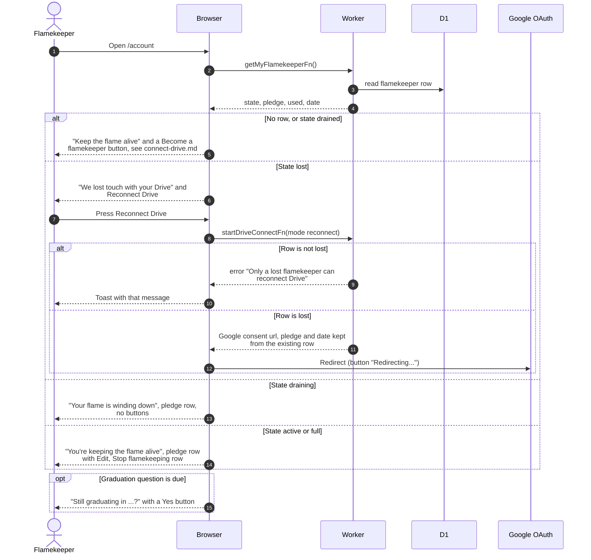

# See the Flamekeeper section on the profile page

> **Question:** What does a person see in the Flamekeeper section on /account for each flamekeeper state?
>
> **Answer:** The profile page loads the person's flamekeeper record. The section only appears for people who have a record or who could sign up (an @nu.edu.kz account that is not flamekeeping). It starts with one muted row holding the Lucide fire icon, a title and a description, and the copy depends on the state. Someone with no record, or a drained one, sees "Keep the flame alive" and a Become a flamekeeper button. An active or full flamekeeper sees "You're keeping the flame alive", a "x GB of y GB pledged" row with a thin bar and Edit, and a Stop flamekeeping row. A draining flamekeeper sees "Your flame is winding down" and the pledge row without buttons. A lost flamekeeper sees "We lost touch with your Drive" with a Reconnect Drive button.
>
> **Notes:**
>
> - The page is one centred column of rows with no tabs or cards, see
>   [GLOSSARY.md](../../../GLOSSARY.md) for the terms.
> - Icon by state. Keeping with photos stored: primary colour, light
>   fill, gentle flicker. Not started, or keeping with nothing
>   stored: primary colour, slow pulse. Winding down: muted. Lost:
>   muted at low opacity. All motion stops under
>   `prefers-reduced-motion`. The copy and icon choice live in
>   `src/lib/flamekeeper/profile-copy.ts`.
> - Which rows show is decided by `getAccessRules`: Edit and Stop
>   only while the state is active or full.
> - A flamekeeper who is not a member sees no About you or Contact
>   section and their Graduating field sits in this section,
>   saved as in [../account/profile-edit.md](../account/profile-edit.md).
>   A member edits Graduating under About you.
> - The text never mentions where photos are kept or that they
>   move. The draining state only survives on records left by
>   earlier code; the hourly drainFlamekeepers step ends them, see
>   ../cron/flamekeepers/steps-and-limits.md.
> - Become a flamekeeper is a link to the `/become-flamekeeper`
>   page. See connect-drive.md.
> - The graduation question appears 365 days after the last
>   confirmation (or after signing up) as a "Still graduating in
>   ..." row with a Yes button, see confirm-graduation.md. It is
>   not shown to lost or drained flamekeepers.
> - Albums hosted is no longer shown.
> - Connection errors from Google are shown under the description,
>   see drive-callback.md for the messages, and a successful
>   connection shows a toast.
> - The reconnect toast shows the server message when there is
>   one, and "Could not reconnect Drive" otherwise.
> - Stopping and editing are in opt-out.md and change-pledge.md.

