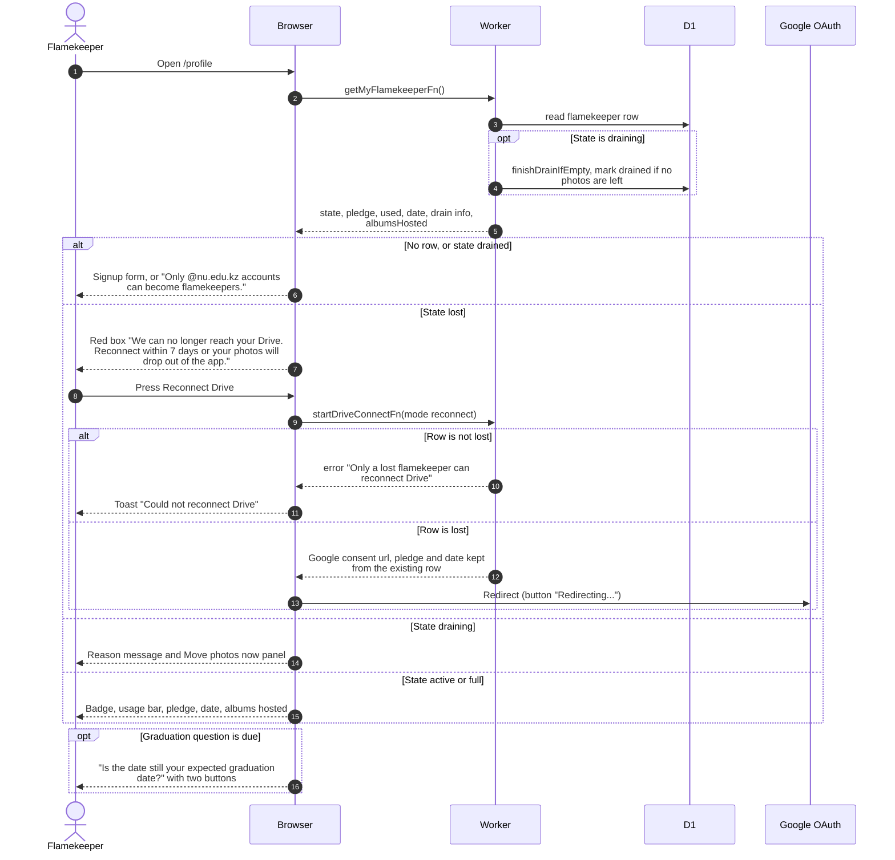

# See the flamekeeper card on the profile page

> **Question:** What does a person see in the flamekeeper card on /profile for each flamekeeper state?
>
> **Answer:** The profile page loads the person's flamekeeper record. A person without a record, or whose record is drained, sees the signup form (or a note that only @nu.edu.kz accounts can join). An active or full flamekeeper sees pledge, usage and buttons to edit the pledge or stop. A draining flamekeeper also sees why their photos are moving and a Move photos now panel. A lost flamekeeper sees a red warning with a Reconnect Drive button. When a yearly graduation question is due, it shows above the numbers.
>
> **Notes:**
> - A draining record is checked on every load. If nothing is
>   left to move, the drain is finished right there (state becomes
>   drained, usage is zeroed and the app's Drive access is deleted).
> - Drain messages by reason. opt_out: "You stopped flamekeeping,
>   so your photos are moving to other flamekeepers." pledge: "Your
>   pledge is below what you hold, so the excess is moving..."
>   graduation: "Your graduation is less than 60 days away..."
>   domain: "Your account is no longer an @nu.edu.kz account..."
>   ban: "Your account was banned..." Each ends with "New uploads
>   no longer go to your Drive."
> - Edit pledge is hidden when the reason is opt_out or domain.
>   Stop flamekeeping is hidden when lost or already opted out.
> - The graduation question appears 365 days after the last
>   confirmation (or after signing up), see confirm-graduation.md.
> - The Move photos now panel is explained in relay-hand-out.md.
> - Albums hosted counts the albums where the person holds a
>   folder that was not dropped and whose album is not deleted.
> - Connection errors from Google are shown in the card, see
>   drive-callback.md for the messages.

