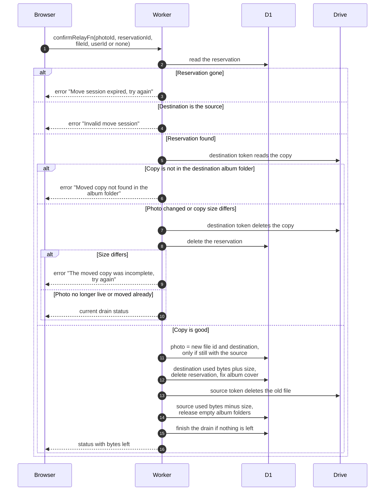

# Confirm a moved photo

> **Question:** What does the server do once the browser says a photo has been copied to the new Drive?
>
> **Answer:** It checks the reservation, looks up the copy in the destination Drive, and checks it sits in the right album folder and has the same size as the original. If so, the photo record now points to the new file and the new flamekeeper, the destination's used space goes up, the old file is deleted from the source Drive, and the source's used space goes down. If the photo changed in the meantime or the copy is wrong, the copy is deleted instead. The reply tells the browser how much is left to move.
>
> **Notes:**
> - Which token is used. The destination flamekeeper's token reads
>   the copy's details and deletes the copy when discarding. The
>   source flamekeeper's token deletes the old file. Both are
>   looked up on the server, never sent by the browser.
> - A stale move means the photo was deleted, is no longer live,
>   or no longer sits with the source. The extra copy is deleted,
>   the reservation is removed and the call still succeeds.
> - If the old file cannot be deleted (other than "already gone")
>   the move still counts and a warning is logged. The old file
>   then stays in the source Drive.
> - If the photo was the album cover, the cover is repointed to
>   the new file.
> - When the source holds nothing more, empty album folders are
>   released and the drain is finished: state becomes drained and
>   the Drive access is deleted.
> - The cached album page is dropped so viewers get the new file.
> - Admin callers pass the source person's id, as in
>   relay-hand-out.md.

