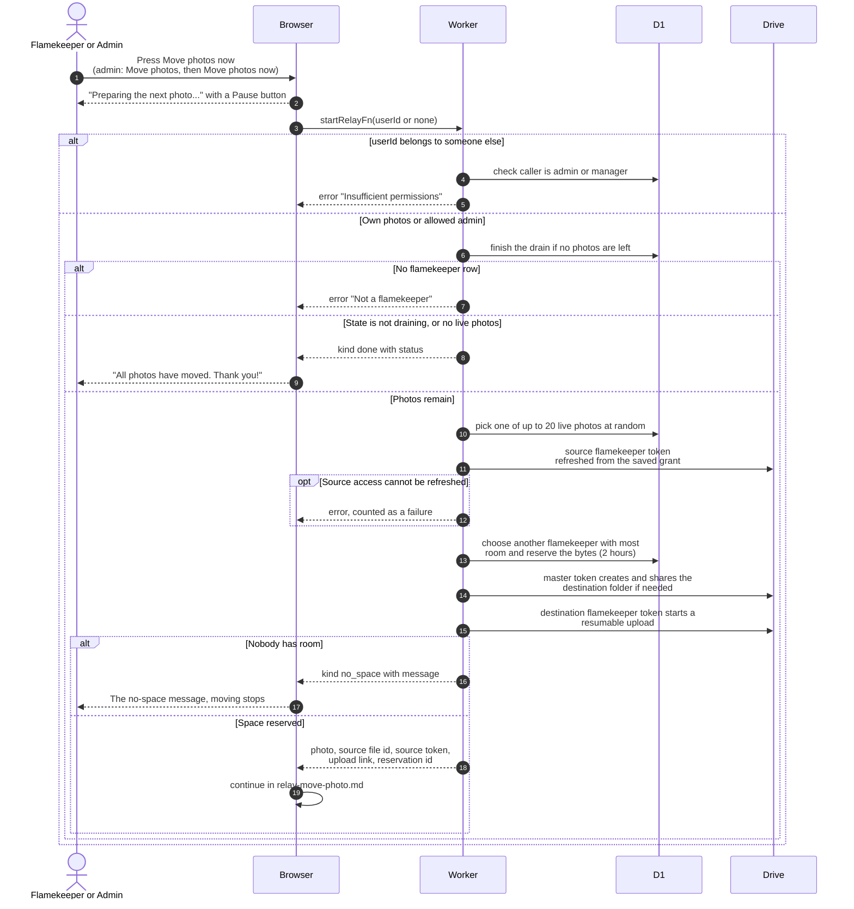

# Start moving a photo off a draining Drive

> **Question:** What happens when someone presses Move photos now, and which account's access does the browser get?
>
> **Answer:** The profile page no longer has a Move photos panel; an admin or manager moves someone's photos from Manage Users. Each round asks the server for one random photo (out of up to 20 candidates). The server picks another flamekeeper with room, reserves the space, and returns three things: the file to read, the permission to read it, and a one-time upload link into the new flamekeeper's folder. If no one has room, the round stops with a message.
>
> **Notes:**
> - Who gets which token. The browser receives the SOURCE
>   flamekeeper's access token, only to download the file. The
>   upload link was created with the DESTINATION flamekeeper's
>   token and needs no token from the browser. The club (master)
>   account creates the destination folder and shares it with the
>   destination, and never reaches the browser.
> - A reservation holds the space for 2 hours. Placement tries up
>   to 4 flamekeepers and never picks the source, the club account,
>   or anyone not active.
> - The source access token is created before the destination is
>   chosen, so it is minted even when the round ends with no space.
>   A saved token is reused for up to 50 minutes.
> - If the source Drive access cannot be refreshed, or another
>   unexpected error happens, the server call fails and the
>   browser counts a failure, see relay-move-photo.md.
> - An admin acts for someone else by passing that person's user
>   id. A person passing someone else's id without the admin or
>   manager role is refused.
> - The copy and its failures are in relay-move-photo.md.
> - Message when nobody has room: "No other flamekeeper has room
>   for these photos right now. Try again once more flamekeepers
>   join."

