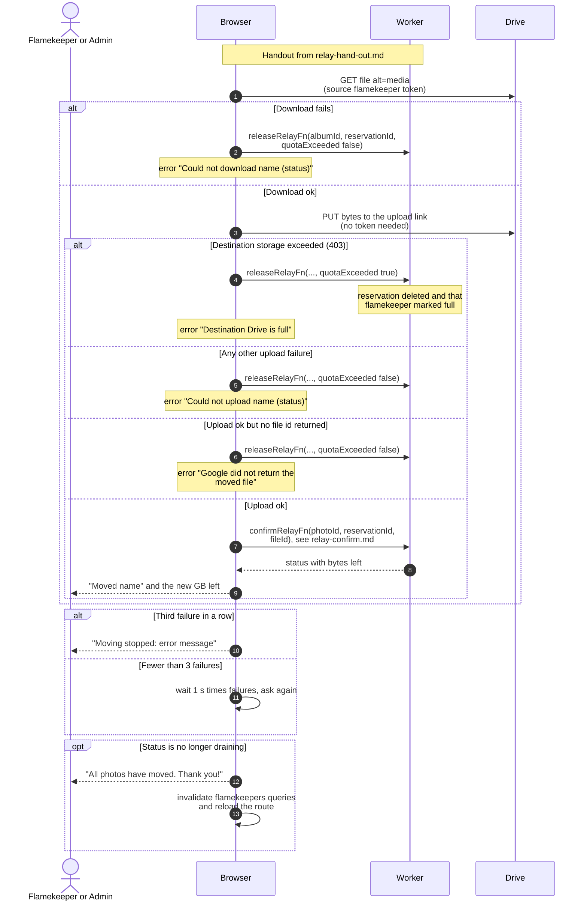

# Copy one photo between Drives in the browser

> **Question:** How does the browser copy a photo to the new flamekeeper, and what happens when the copy fails?
>
> **Answer:** The browser downloads the photo from the source Drive with the source token, then uploads the bytes to the upload link for the destination folder. If both succeed it tells the server to confirm the move, and the loop asks for the next photo. If a step fails, the browser tells the server to release the reserved space, then retries after a short wait. After 3 failures in a row it stops and shows the error. The Pause button stops the loop after the current step.
>
> **Notes:**
> - Photos move one at a time through the browser of whoever
>   pressed the button. Closing the tab asks for confirmation
>   while moving, and the loop stops if the page is left.
> - Waits between retries are 1 s, then 2 s. The third failure in
>   a row stops with "Moving stopped: " followed by the error.
>   Any success resets the count.
> - The release call is sent without waiting and its own failure
>   is ignored. The reservation also expires by itself after 2
>   hours.
> - If the destination Drive says its storage is exceeded, the
>   release marks that flamekeeper as full, so no further photos
>   are placed there.
> - The server side of a successful copy is in relay-confirm.md.
> - Progress text: "Preparing the next photo...", then "Moved
>   name", with "N photos moved so far" and a progress bar.

