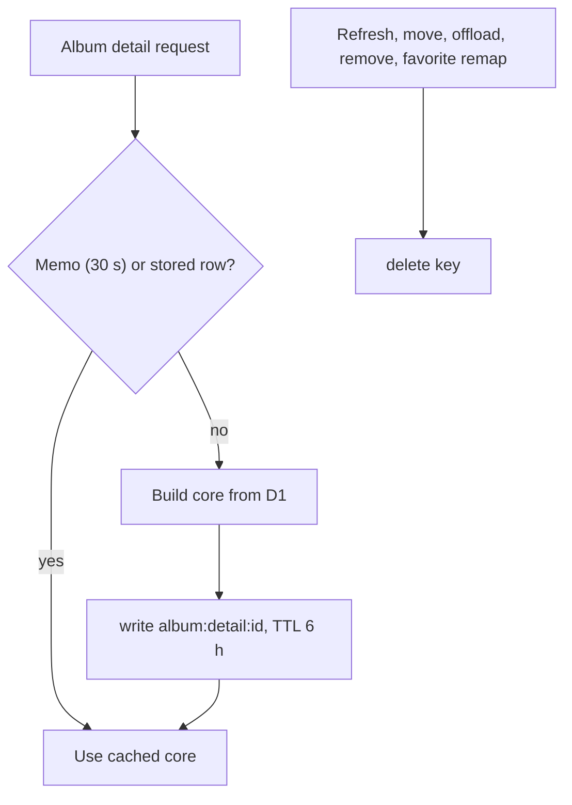

# State: album-detail

Key `album:detail:{albumId}`. Stored in the D1 `app_state` table (`src/lib/app-state.ts`), not in KV, since [ADR-0022](../../adr/0022-caches-and-flow-state-in-d1.md).

How is the viewer-independent part of an album page cached?

- Value: JSON album core (the parts that do not depend on who is viewing). TTL 6 hours; it only bounds how long an unnoticed change, such as a renamed author, can linger.
- Writer and reader: `getCachedDetailCore` and `setCachedDetailCore` used in `src/lib/albums/functions.ts` (detail loader). Invalidated by `invalidateCachedDetailCore` in `remove.ts`, `storage-server.ts`, `favorites/remap-server.ts`.
- A 25-entry, 30-second memo per isolate absorbs repeat traffic in front of D1.
- Why: the page is hit by shared links; the core is the same for everyone, and the memo plus explicit invalidation keeps writes low.
