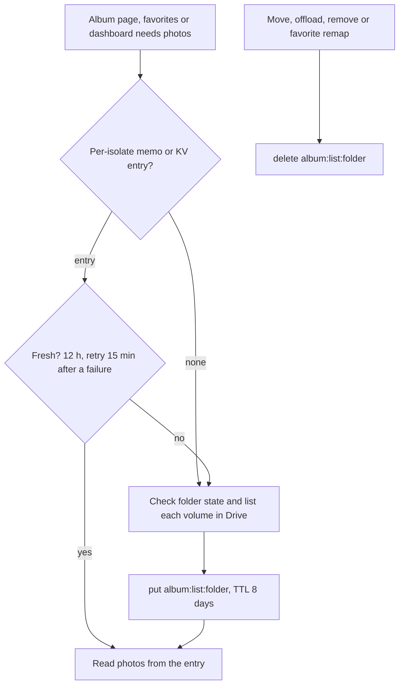

# KV: album-listing

Key `album:list:{driveFolderId}`.

How does an album page avoid listing Drive folders on every view?

- Value: JSON listing entry per source (`buffer:{volumeId}` and `flamekeeper:{volumeId}`): files, folder state, last check times. TTL 8 days (`LISTING_KV_TTL_SECONDS`); a stale entry is served up to 7 days when Drive fails.
- Writer: `setCachedListing` from `loadAlbumListing` (`src/lib/albums/listing-server.ts`), only when the entry changed. Readers: the same function, `src/lib/favorites/functions.ts`, `src/lib/admin/functions/dashboard-stats.ts`. Invalidated in `remove.ts`, `storage-server.ts` and `favorites/remap-server.ts`.
- A 50-entry memo per Worker isolate holds the last written entry, so a refused KV write (free tier: 1,000 writes a day) does not trigger another Drive listing.
- Not in KV: the public album list page (edge Cache API, 10 minutes) and guest HTML in `server.ts`, both to avoid KV write limits.
- Why: listing Drive costs outside requests and seconds; the cache also feeds the photo count and total bytes synced to `album` ([albums-and-storage](../erd/albums-and-storage.md)).
