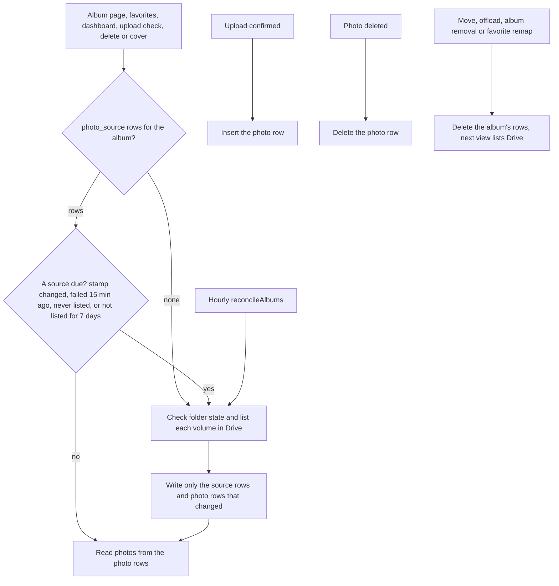

# State: album photos

Tables `photo` and `photo_source`, plus `album.folderState` and `album.photosCheckedAt`. Code: `src/lib/albums/photo-store.ts` (reads and writes), `photo-rows.ts` (the row plan), `listing.ts` (the rules). Decision: [ADR-0023](../../adr/0023-photos-are-rows-reconciled-with-drive.md).

How does an album page show photos without listing Drive?

- `photo_source`: one row per place photos are listed from (`buffer:{volumeId}`, `flamekeeper:{volumeId}`, or `master` for the album's own folder, which only older albums have photos in) with its folder, the volume stamp it matched (`expectedCount:expectedBytes`), status (`ok`, `partial`, `failed`, `missing`, `unavailable`) and when it was last listed or last failed.
- `photo`: one row per file under `(albumId, sourceKey, fileId)`. `meta` is the Drive file as listed (name, type, size, checksum, EXIF); `size` and `md5` are copied out for queries. The primary key is the only index: D1 bills every index entry as a row written. Rows read back in insertion order, which is Drive's creation order.
- The hourly [reconcileAlbums](../cron/hourly.md) step is what notices changes made in Drive behind the app. It takes the albums checked longest ago, at most 10 an hour and usually fewer, since it only gets the requests the other steps leave. An album is eligible again 24 hours after its last check (`LISTING_RECONCILE_MS`), but with a couple of thousand albums one pass over all of them takes about two weeks.
- A view lists Drive because of age alone only when a source has gone 7 days without a listing (`LISTING_FRESH_MS`), which covers the albums the hourly step has not reached.
- An upload inserts its row at confirm, so the photo shows at once and the duplicate check sees it. The confirm also changes the volume's stamp, so that buffer volume is listed once more after the upload burst settles (at most every 5 minutes during it), which fills in EXIF that Drive had not extracted yet.
- A listing that found the same files writes only the source row. A listing that could not finish keeps the previous rows of the sources it did not reach, and a source that keeps failing shows its last photos for up to 7 days.
- A move gives every photo a new Drive file id, so it deletes the album's rows and the next view lists Drive, as before.
- Deleting a photo and setting a cover are authorized against these rows: the file must be a row of this album, and its source says whose token acts on it. A miss lists Drive once before refusing.
- The rows also feed the photo count and total bytes on `album` ([albums-and-storage](../erd/albums-and-storage.md)), and `album.folderState` feeds the dashboard's "folder in the bin or deleted" alert.
- Elsewhere: the public album list page (edge Cache API, 10 minutes) and guest HTML in `server.ts`.
