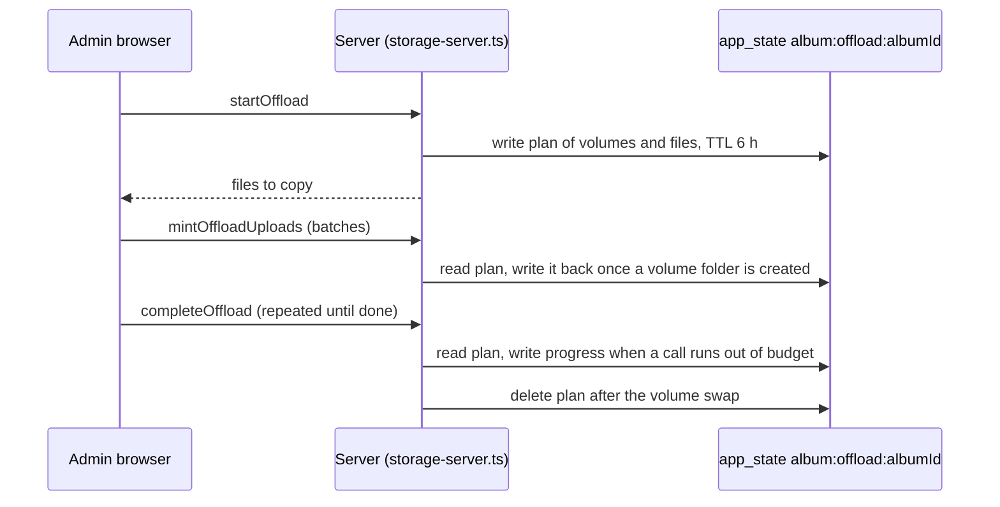

# State: album-offload

Keys `album:offload:{albumId}` and `album:rescue:{albumId}`. Stored in the D1 `app_state` table (`src/lib/app-state.ts`), not in KV, since [ADR-0022](../../adr/0022-caches-and-flow-state-in-d1.md).

How does an admin-started move to flamekeepers survive between its browser steps?

- Value: JSON `OffloadPending`: the buffer folders it was planned from, the folders already checked, photos deleted meanwhile, and per destination volume its id, `destUserId`, folder and permission once created, bytes, files (with their source folder), and after verification the copies and duplicate copies. TTL 21600 s from the last write.
- A second `startOffload` for the same album reuses the plan when every buffer photo is in it and the flamekeepers still have room; otherwise it writes a new plan.
- A missing key returns "This move expired, start it again", unless the album already moved, which counts as done.
- While either key exists, uploads to the album are refused (offload only) and the cleanup of dropped volumes leaves the album alone, so copies being made are not deleted.
- `album:rescue:{albumId}` is written on each Move to Buffer or drain run of that album, TTL 24 h, and deleted after its volume swap. It protects the staged buffer copies of a rescue that needs several runs.
- Why: the photos are copied through the admin's browser across several calls, and the server must not trust the browser to say where files go.
