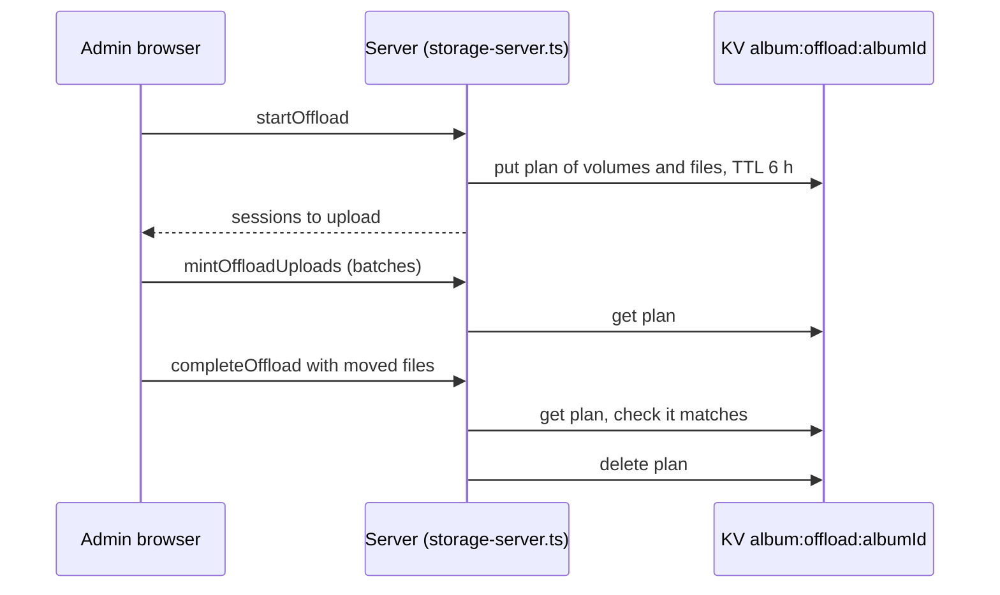

# KV: album-offload

Key `album:offload:{albumId}`.

How does an admin-started move to flamekeepers survive between its browser steps?

- Value: JSON `OffloadPending`: per destination volume `destUserId`, `volumeFolderId`, `permissionId`, `bytes`, and the files. TTL 21600 s.
- A second `startOffload` for the same album reuses the plan if the source files and free space still fit.
- A missing key returns "This move expired, start it again". A mismatch on completion is refused.
- Why: the photos are copied through the admin's browser across several calls, and the server must not trust the browser to say where files go.
