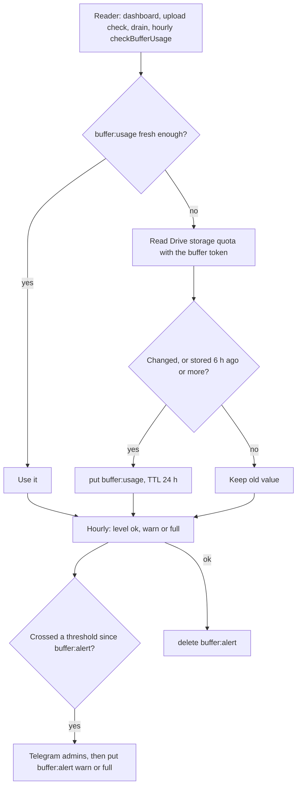

# KV: buffer-usage

Keys `buffer:usage` and `buffer:alert`. Both belong to the buffer account's storage monitoring ([GLOSSARY.md](../../../GLOSSARY.md)).

How are buffer usage and its alerts kept without calling Drive on every page?

- `buffer:usage`: JSON `{ usedBytes, limitBytes, checkedAt }`, TTL 86400 s. Cron refreshes when older than 50 minutes (4 requests); other callers pass their own max age. Code: `src/lib/buffer/usage-server.ts`, rules in `src/lib/buffer/usage.ts`.
- `buffer:alert`: the string `warn` or `full`, no TTL. `warn` alerts once when the configured percent is crossed, `full` once at 100%. Returning to ok deletes it so the next crossing alerts again.
- If Telegram is over budget the marker is not written, so the alert is retried.
- Why: the Drive quota call is slow and costs a request; the 6-hour rewrite rule limits KV writes. The marker makes alerts once per crossing.
