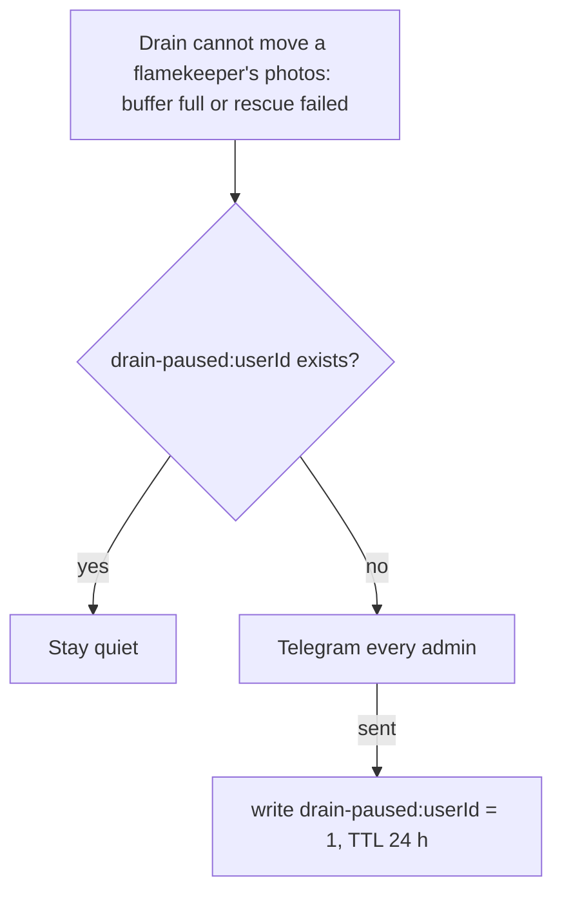

# State: drain-paused

Key `drain-paused:{userId}` where `userId` is the draining flamekeeper. Stored in the D1 `app_state` table (`src/lib/app-state.ts`), not in KV ([ADR-0022](../../adr/0022-caches-and-flow-state-in-d1.md)).

How does the hourly drain avoid spamming admins when it is stuck?

- Value: the string `1`. TTL: 86400 s.
- Writer and reader: `alertOncePerDay` in `src/lib/pool/drain-cron.ts`, called by `drainFlamekeepers` ([hourly.md](../cron/hourly.md)).
- Failures of marker reads and writes are logged and ignored, so an outage may repeat an alert.
- Why: the step runs every hour, so without the marker a blocked drain would alert 24 times a day. Nothing is deleted while paused.
