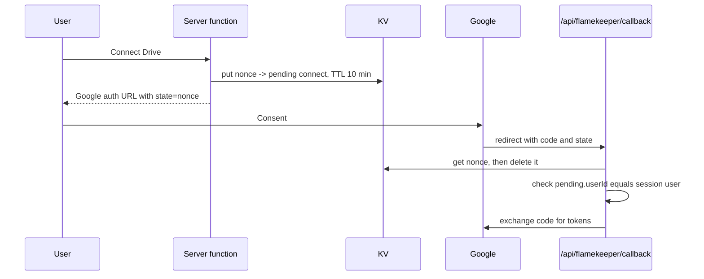

# KV: flamekeeper-oauth

Key `flamekeeper-oauth:{nonce}`. The nonce is a random UUID.

How does the Drive connect flow keep its state across the Google redirect?

- Value: JSON `PendingConnect` with `userId`, `pledgedBytes`, `graduationDate`, `termsAcceptedAt`. For a Lost flamekeeper reconnecting it is built from the existing `flamekeeper` row.
- TTL: 600 s.
- Writer: `src/lib/flamekeeper/functions.ts` (start of connect). Reader and deleter: `src/routes/api/flamekeeper.callback.ts`.
- Why: it carries the pledge and terms acceptance through the redirect without trusting the browser, makes the `state` unguessable, and is single-use because the callback deletes it on first read. A missing or expired key sends the user back to `/become-flamekeeper` with a state error.
