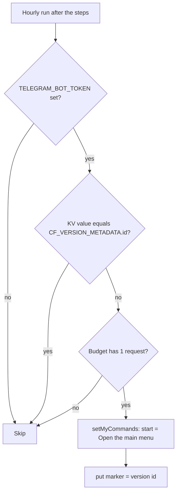

# KV: telegram-bot-version

Key `telegram-bot:configured-version`.

When does the hourly run call Telegram to set the bot commands?

- Value: the deployed Worker version id (`unversioned` when the binding is absent). No TTL.
- Writer and reader: `configureTelegramBotOncePerDeploy` in `src/lib/telegram/configure.ts`, called from `server.ts` on the hourly trigger only.
- Why: command lists change only on deploy, so one Telegram call per deploy replaces one per hour. If the call throws, the marker is not written and the next hour retries.
- The menu button is managed in BotFather and not touched.
