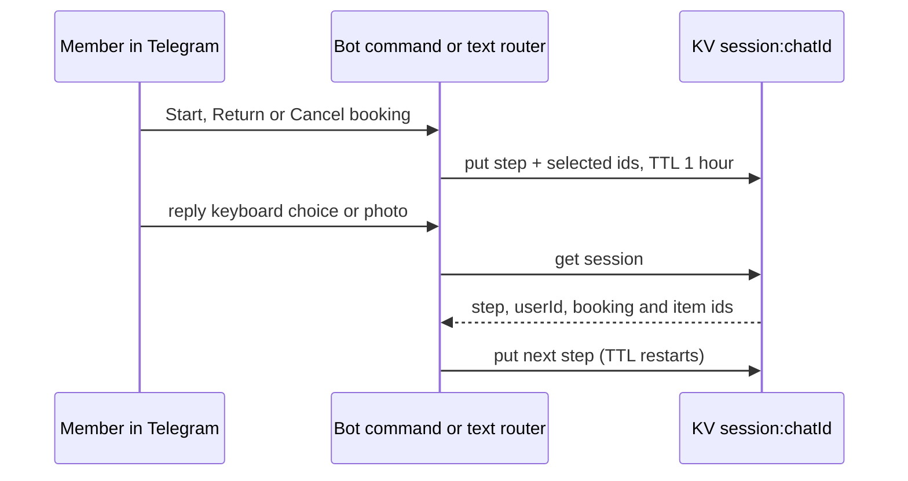

# KV: telegram-session

Key `session:{chatId}`. Binding `meriksirat_kv`.

What does the bot remember between messages of a flow?

- Value: JSON `SessionData` with `step` (`awaiting_booking_selection`, `awaiting_item_selection`, `awaiting_photo`, `awaiting_start_selection`, `awaiting_start_confirm`, `awaiting_cancel_selection`, `awaiting_cancel_items`, `awaiting_cancel_confirm`), `userId`, the booking and item ids chosen so far, and `createdAt`.
- TTL: 3600 s, restarted on each write. There is no delete; an abandoned flow expires.
- Writers: `src/lib/telegram/commands/{start-booking,end-booking,cancel-booking,text-router}.ts` through `setSession`. Readers: `text-router.ts` and `photo.ts` through `getSession` (`src/lib/telegram/kv-session.ts`).
- Why KV: a Telegram update is a stateless webhook call, and the flow state is short-lived, so it needs no D1 row or migration.
