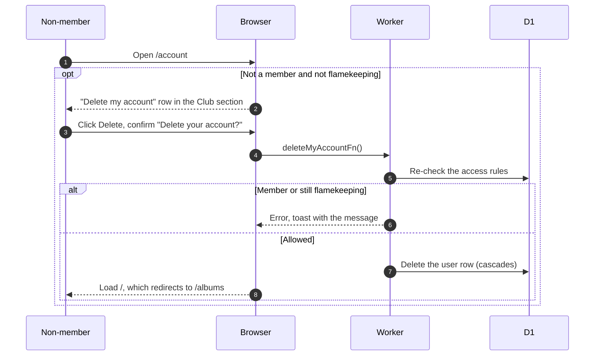

# Delete account

## Who can delete their account, and what happens?

- Club members cannot delete their account. Membership is permanent ([GLOSSARY](../../../../GLOSSARY.md)).
- A flamekeeper whose flamekeeping has stopped counts as not flamekeeping and may delete. Any other flamekeeper state blocks it.
- The cascade removes sessions, linked Google accounts, Telegram tokens, favorites and the flamekeeper row.
- Nothing else deletes accounts. Unfinished sign-ups are never removed.
