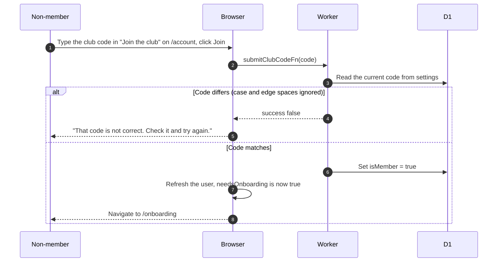
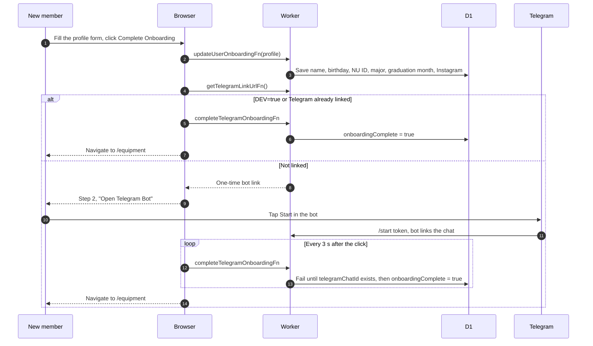

# Join the club and onboarding

## How does a non-member become a member?

- The code lives in the global settings row and is managed by admins. If none exists yet, the first check creates a random one, so that first attempt fails.
- Joining does not touch an existing flamekeeper record ([ADR-0011](../../../adr/0011-membership-and-flamekeeping-are-separate.md)).

## How does a new member finish onboarding?

- Required: first name, last name, birthday, NU ID (positive whole number), major, graduation month. Instagram is optional and the birthday greeting box starts ticked. Terms were accepted at sign-in, so onboarding asks nothing about them.
- Any save failure shows "Failed to save profile information. Please try again." Examples: an NU ID already used by another account, or a graduation month a flamekeeper cannot have.
- Saving the form does not complete onboarding. Linking Telegram does. The bot also sets `onboardingComplete` when it links the chat. Finishing refreshes the birthdays calendar, and a failure there is only logged.
- Polling starts at the click, ignores every error and never fetches a new token. After the 10 minute token expires the bot answers "Link expired or invalid", unless the chat is already linked.
- Until onboarding is complete the member is redirected to `/onboarding` from every signed-in page, see [access gate](../../anon/access-gate.md).
