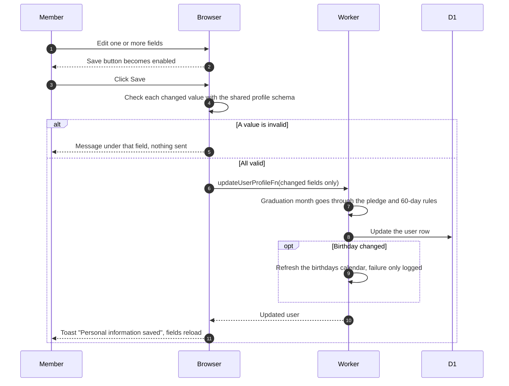
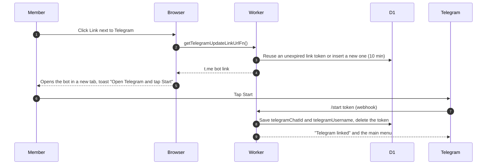

# Personal information

`/account` ("My Account") is open to members and non-members. Members get a Personal Information section and a read-only Club section (status, role, clearance, joined month). Non-members get the Club section with the join row, see [join club and onboarding](join-club-and-onboarding.md). A non-member who is a flamekeeper sees Graduating in the flamekeeper section instead.

## How does a member change their details?

- Editable: first name, last name, birthday, major, graduation month, NU ID, Instagram. Email is locked.
- Names, NU ID, birthday and graduation month cannot be cleared. Major and Instagram can. A leading `@` on Instagram is dropped.
- A flamekeeper must enter a future graduation month. A nearer date follows the pledge rules in [flamekeeper account](../../flamekeeper/account/).

## How does a member link or relink Telegram?

- The Link button shows only while no Telegram username is saved. Until the bot saves it, the page keeps showing "Not linked" and does not refresh by itself.
- If the Telegram account has no username, the saved username stays unchanged.
- The bot side is in [link account](../telegram/link-account.md).
