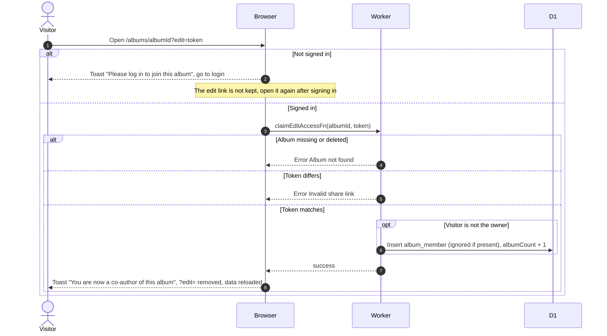
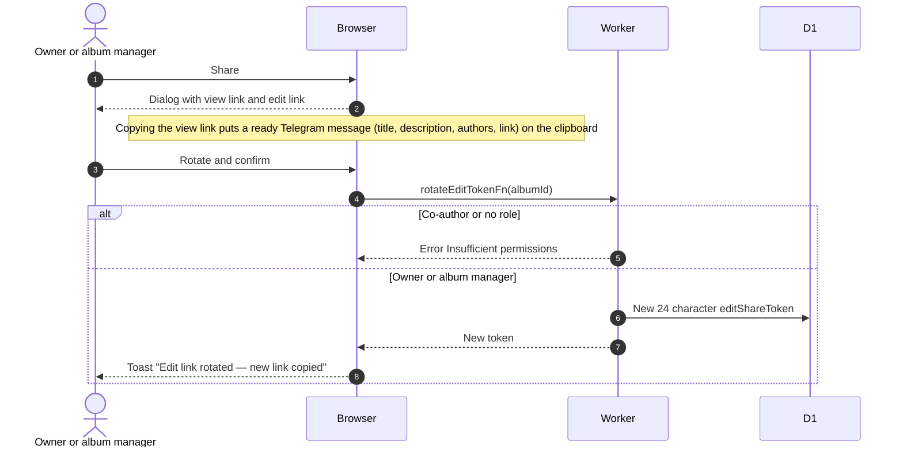
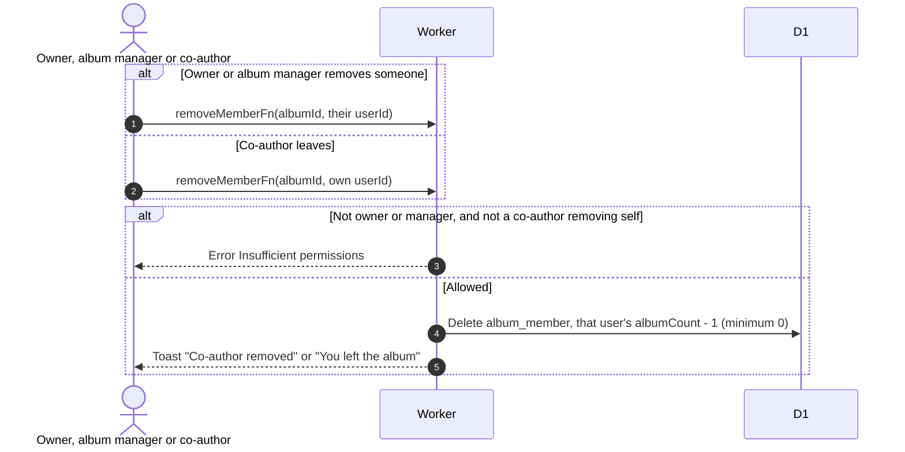

# Co-authors and the edit link

Related: [create](create.md), [GLOSSARY: Co-author](../../../../GLOSSARY.md).

## How does someone become a co-author?

The edit link is the album address with `?edit=` and the album's 24 character edit token.

- The link works for any signed-in user. It checks neither club membership nor clearance. There is no approval step.
- Co-authors can upload, edit details, refresh, set the cover and delete photos. They cannot delete the album, rotate the link or remove others.
- Opening the link again adds no second membership, but albumCount goes up by 1 each time a non-owner uses it.

## How is the edit link shared and rotated?

Co-authors see the Share dialog and can copy both links but have no rotate button. Rotating cancels every earlier link and keeps existing co-authors. Visitors without a role never receive the token.

## How does a co-author leave or get removed?

- The page offers no way to remove the owner. The Worker does not refuse it, so only the page protects the owner.
- Photos the co-author uploaded stay. The Leave button is shown to co-authors only, so an admin who joined by link has none.
