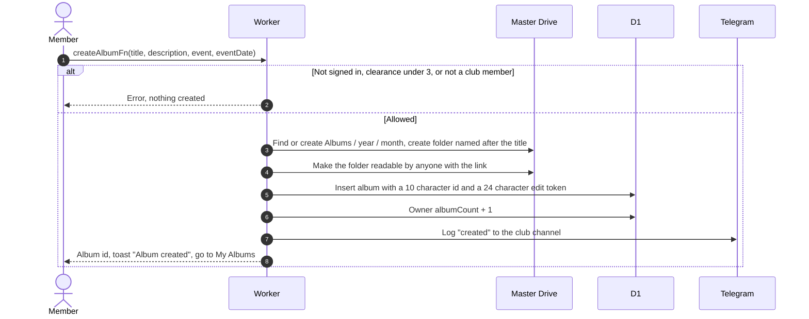
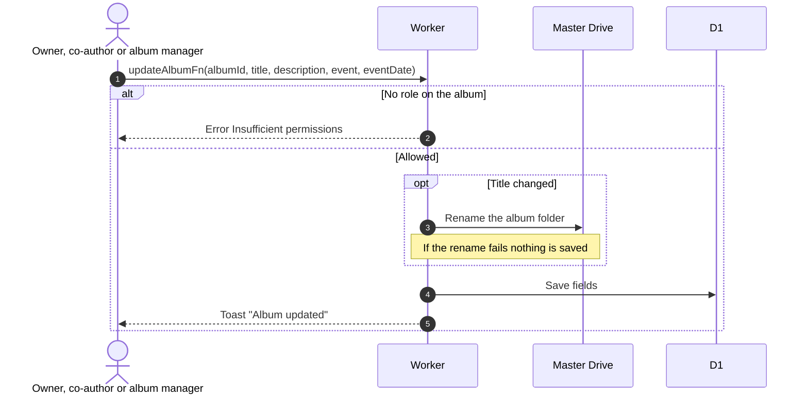

# Create and edit an album

Related: [upload](upload.md), [co-authors](co-authors.md), [ADR-0005](../../../adr/0005-album-drive-folders-are-always-public.md).

## What happens when a member creates an album?

- The folder belongs to the master account. It holds no photos. Photos are uploaded later into Volume folders owned by the buffer, see [upload](upload.md).
- The member flag set by an admin is required, and clearance level 3 or higher. Clearance alone is not enough.
- The month folder uses the current UTC date, not the event date.
- Albums do not expire. They are deleted only by their owner or an admin, or on a date an admin schedules, see [delete-album](delete-album.md) and the [GLOSSARY](../../../GLOSSARY.md).
- If the database insert fails after the folder was made, the empty folder stays in Drive.

## What happens when someone edits the details?

Pinning is an admin action, see [admin albums](../../admin/albums/).
