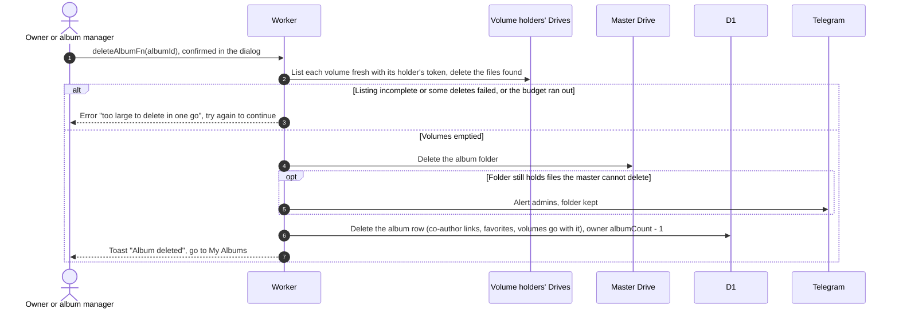

# Delete an album

Related: [warnings](warnings.md) for a folder that is already gone, [ADR-0012](../../../adr/0012-no-backup-albums-expire.md).

## What happens when the owner or an admin deletes an album?

Only the owner and album managers can. There is no backup.

- What is left in Drive is the progress, so a retry continues where the last run stopped. Nothing is stored between attempts.
- Files of a flamekeeper whose Google connection is lost cannot be listed or deleted. They are left and the album row is still removed.
- Only the owner's album count drops. Co-authors' counts do not change.
- A scheduled deletion runs this same removal from the hourly cron and also removes the row. A tombstone is kept only for a folder that is permanently gone, see [cron](../../cron/).
