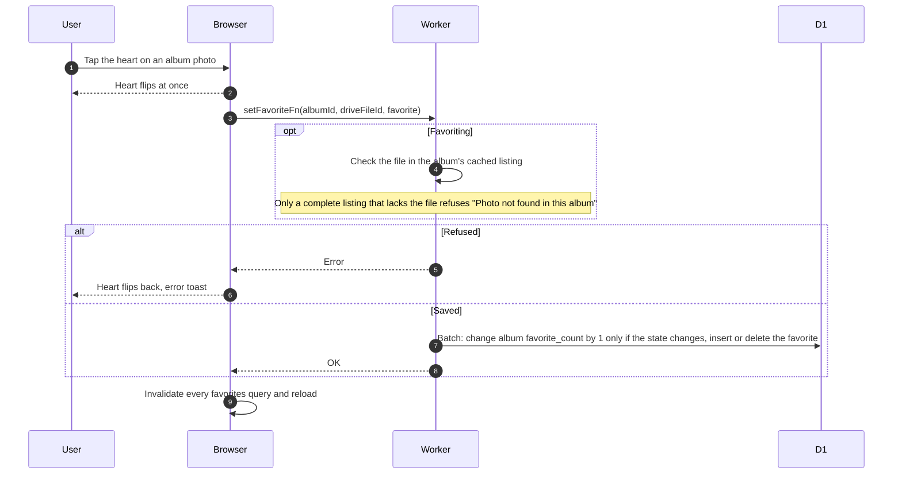
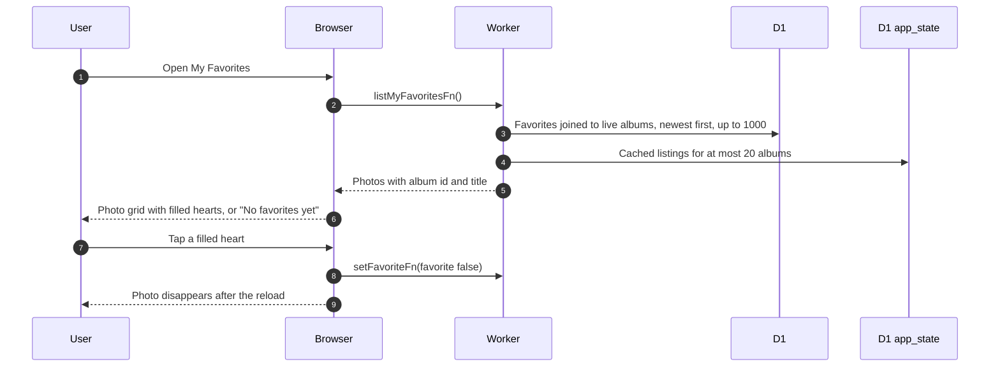

# Favorites

Favorites are saved album photos, not equipment. Any signed-in user may favorite, members and non-members alike, and `/favorites` is open to both ([GLOSSARY](../../../../GLOSSARY.md)).

## What happens when a user taps the heart on a photo?

- A favorite is keyed by user, album and Drive file id. The count never drifts on repeated taps and never drops below 0.
- When a photo moves to a new Drive file, favorites and the album cover are remapped to the new id.

## What does My Favorites show?

- The page makes no Drive calls. A photo whose listing is not cached or incomplete still shows, named "Photo". A photo missing from a complete listing is left out silently.
- Unlike the album page, nothing changes until the server answers.
- A load failure is only logged and shows the empty state.
