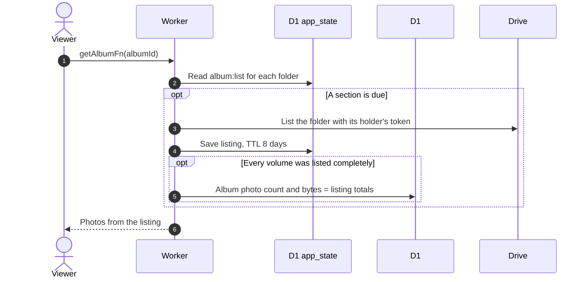

# Albums from before the buffer

Related: [refresh](refresh.md), [upload](upload.md), [ADR-0017](../../../adr/0017-drop-photo-table-read-from-drive.md).

## Does an older album behave differently?

No. It is read like any album from cached Drive listings. Photos in the album's root folder are listed with the master token, and photos a flamekeeper still holds are listed from that flamekeeper's volume.

- There is no photo table and no indexer, so nothing has to be recorded before an old album works.
- Old flamekeeper and master volumes have no expected count, so they never raise the fewer-photos warning, see [warnings](warnings.md).
- Delete and cover work the same, but delete uses the holding flamekeeper's token, see [photos](photos.md).
