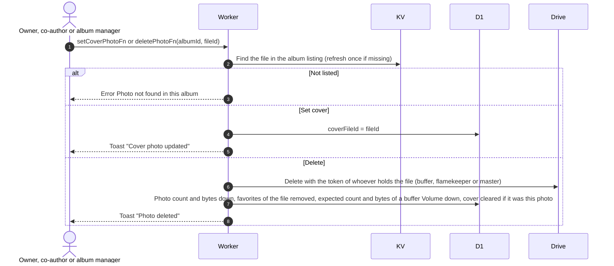
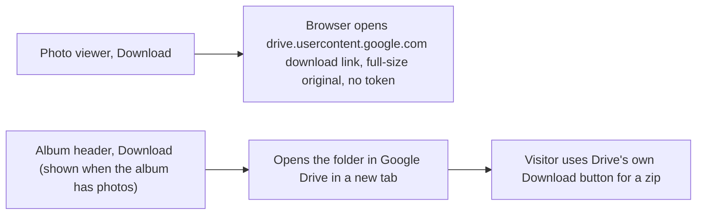

# Cover, delete and download photos

Related: [refresh](refresh.md), [ADR-0017](../../../adr/0017-drop-photo-table-read-from-drive.md).

## How does someone set the cover or delete a photo?

The owner, co-authors and album managers can do both from the photo viewer. Both are checked against the album's own listing.

- A file that is not in this album's folders is never touched, so a cover or delete cannot reach another album. The caller's own Google token is never used.
- If the holder's token cannot be used, the error is shown and nothing changes.
- With no cover chosen, the earliest uploaded photo is used and saved at the first complete listing.

## How does a visitor download?

Every album folder is readable by anyone with the link, so the Worker is not involved. Google offers anonymous visitors no zip of a folder, so the folder link is the only whole-album download. There is no backup, see [ADR-0012](../../../adr/0012-no-backup-albums-expire.md).
