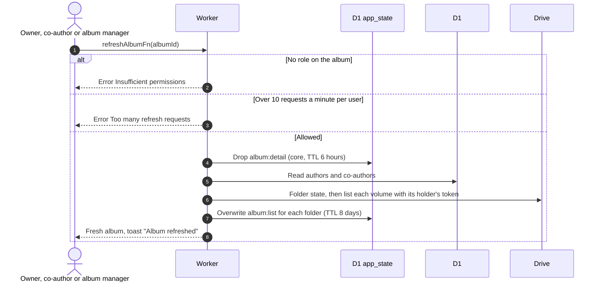

# Refresh an album

Related: [warnings](warnings.md), [ADR-0017](../../../adr/0017-drop-photo-table-read-from-drive.md).

## What does Refresh do?

Albums are read from cached Drive listings, not from a photo table. Refresh forces a new read of every volume.

- A volume that fails to list keeps its last good listing, so Refresh never empties an album because Drive had a bad moment.
- The page shows the returned album directly, so warnings appear even if the cache write is refused.
- Not needed after an upload. It picks up changes made outside the app before the listing is due again (listings are fresh for 12 hours).
- Folder health (ok, in the bin, deleted) is re-checked each time, see [warnings](warnings.md).
