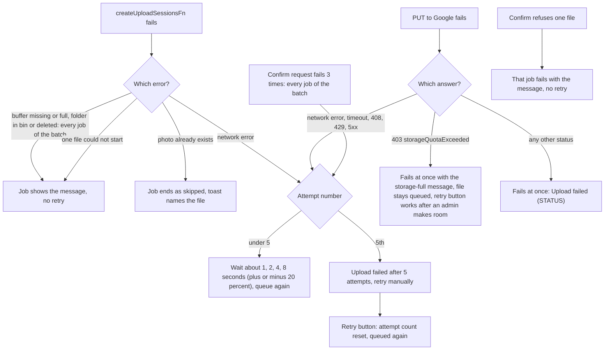

# Upload failures and retries

Related: [upload](upload.md).

## What happens when an upload fails?

- An uploaded file waits up to 4 seconds to share a confirm request. If the page reloads in that window, the job starts over and uploads a second copy, as when confirm keeps failing.
- If confirm keeps failing, the file may sit in the buffer's Volume folder without being counted. The next complete listing corrects the totals, and a retry uploads the photo again as a second file.
- Cancel aborts the transfer and marks the job Cancelled. Finished jobs vanish after 1 hour (done, cancelled) or 7 days (failed).

## What does the rest of the system do after an upload?

Nothing runs in the background for new uploads. The album page lists the buffer again when its expected count changed, so a new photo shows without Refresh, see [refresh](refresh.md). Hourly cron deletes albums an admin scheduled for deletion, see [cron](../../cron/). Flamekeepers hold no new photos.
