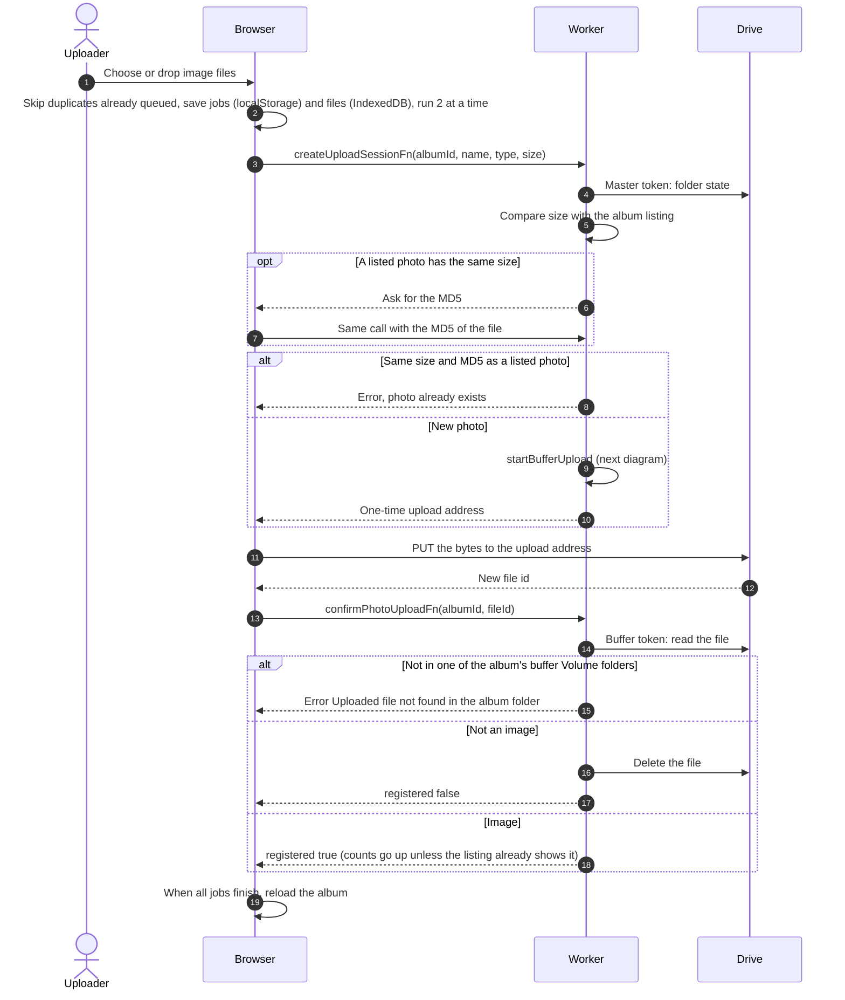
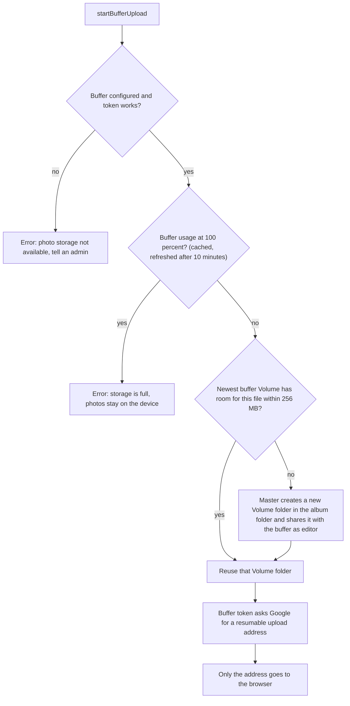

# Upload photos

Related: [failures and retries](upload-failures.md), [ADR-0015](../../../adr/0015-buffer-is-stable-photo-storage.md), [ADR-0017](../../../adr/0017-drop-photo-table-read-from-drive.md), [ADR-0019](../../../adr/0019-256mb-volumes-several-per-holder.md).

## How does a photo get from the browser to the buffer's Drive?

The owner, co-authors and album managers can upload. The bytes go straight from the browser to Google, never through the Worker.

- Files up to 5 GB. Filenames are ignored for duplicate detection: size first, then MD5 hashed in the browser only when a size matches.
- The queue survives a page refresh. A job whose file is gone fails with "File is no longer available — choose it again".
- Uploads are paused while the album folder is in the bin or deleted, see [warnings](warnings.md).
- Confirming adds 1 and the file size to the Volume's expected count and bytes and to the album's photo count and bytes. A confirm for a file the cached buffer listing already shows is accepted without adding.

## Where does the photo go?

- Every new photo goes to the buffer. There is no fallback to a flamekeeper. See the glossary for [Volume](../../../../GLOSSARY.md).
- A Volume folder that vanished from Drive is recreated once, and only while that Volume has no photos. Otherwise the upload stops with "The album storage folder could not be found in Google Drive, so uploads are paused."
- Photos that flamekeepers held before the buffer stay where they are, see [legacy](legacy.md).
