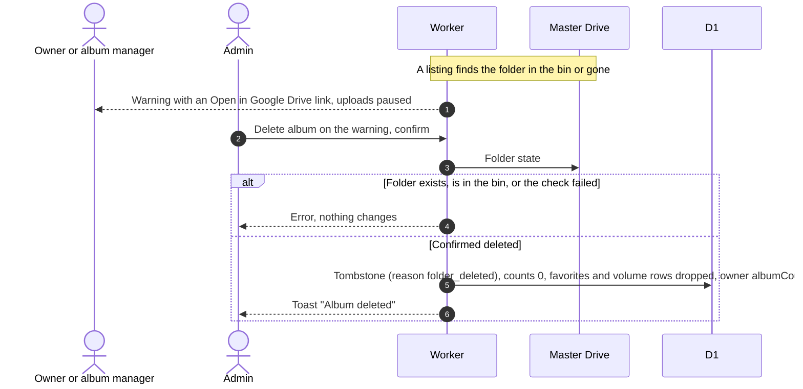
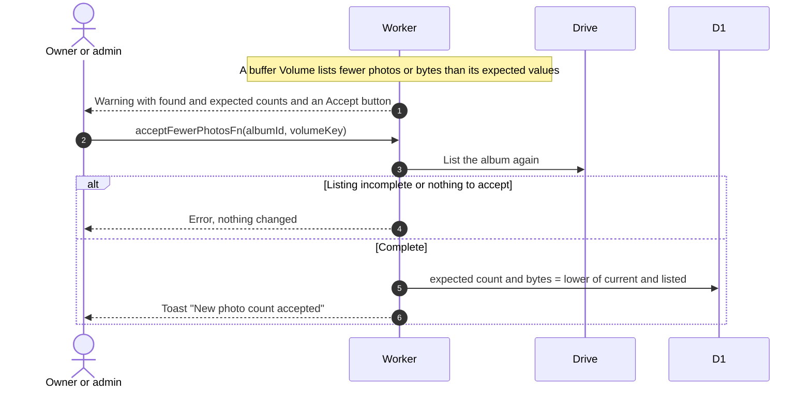

# Album warnings

Related: [refresh](refresh.md), [GLOSSARY: Folder state](../../../../GLOSSARY.md), [admin albums](../../admin/albums/).

## What happens when the album's Drive folder is in the bin or deleted?

- The app never restores or recreates a folder. An owner can take a binned folder out of the bin in Drive.
- Only admins get the button, not managers. Nothing is deleted in Drive, files in flamekeepers' Drives are left alone.
- The state is noticed when the hourly reconcile next checks the album (it works through all albums in about two weeks), when a view has to list Drive (after 7 days at most), or on Refresh.

## What does "Fewer photos than expected" mean?

- Only buffer Volumes warn, and only from a complete, fresh listing with a healthy folder. Photos added by hand in Drive never raise it.
- Accept re-lists on the Worker and ignores files created in the last 10 minutes, so a late confirm cannot be undone. The values only go down.
- Admins also see the Volume's Drive link and holder.
