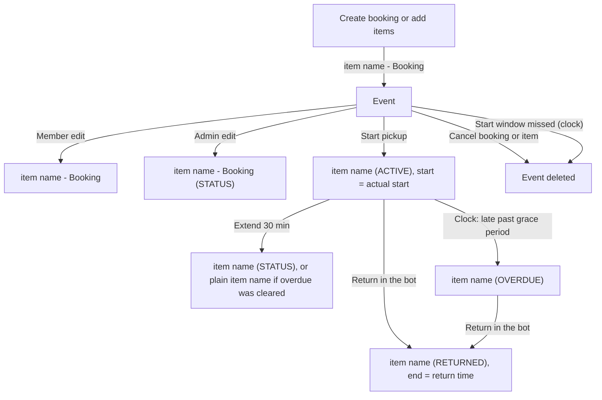

# Calendar event titles

Each booking item has its own event in its equipment's calendar, in club time (Asia/Almaty). The description lists booking id, user, equipment, booked time, actual start and return when known, status in capitals and notes.

## What is an event's title at each step?

- "item name" is the equipment model name, or "Equipment id" when it has none.
- Event start is the actual start once the booking has started, otherwise the booked start. End is the booked end, or the return time after a return.
- A member edit always writes "- Booking", even after the booking is no longer booked. The overdue event is written in UTC, which shows the same moment.
- The overdue and no-show steps are in [every 5 minutes](../../cron/every-5-min.md).
