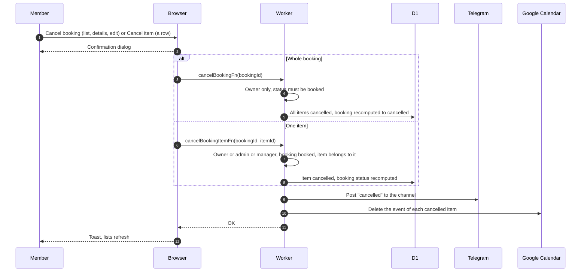

# Cancel a booking or an item

Only a booked booking can be cancelled from the web. Once started, it is returned through the bot, see [pickup and return](pickup-and-return.md). Bookings that are never picked up are cancelled by the clock, see [every 5 minutes](../../cron/every-5-min.md).

## What happens when a member cancels?

- The booking status is derived from its items ([ADR-0006](../../../adr/0006-parent-status-derived-from-items.md)), so cancelling the last live item cancels the booking and the other items stay booked otherwise.
- Database changes come first. A failed recompute, channel post or event delete is only logged, so equipment is freed even if the post fails. A failed event delete leaves the event on the calendar, without a retry.
- Bulk: ticking bookings in My Bookings and "Cancel Selected" sends one cancel per booked booking in parallel and reports "Cancelled N bookings" and any failures. Non-booked ones are skipped.
- The edit page toast reads "Booking cancelled successfully!" and goes back to My Bookings after 1.5 seconds.
