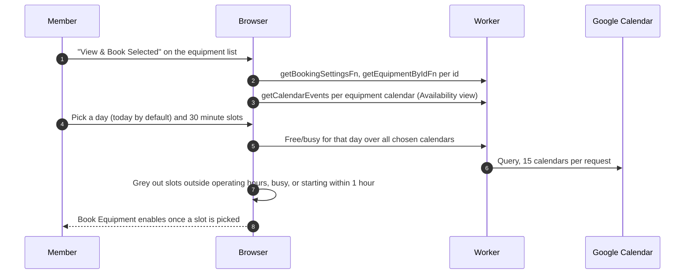
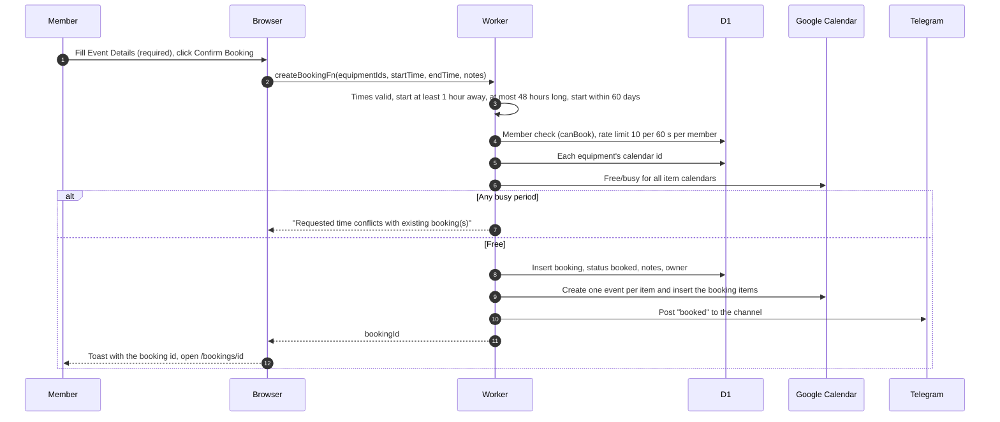
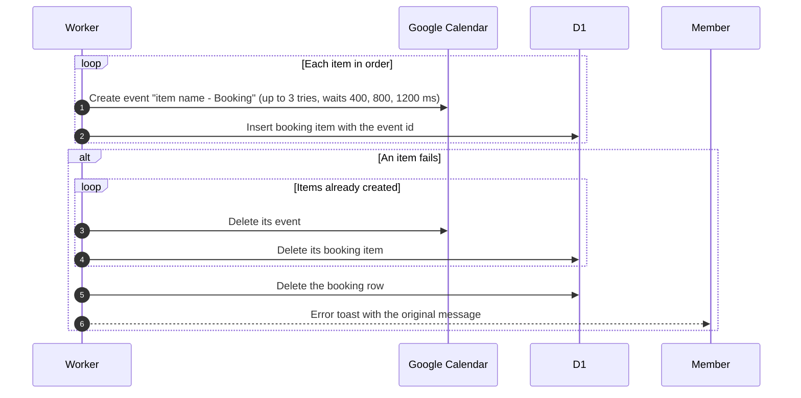

# Create a booking

## How does a member pick equipment and a time?

- The booking runs from the first picked slot to 30 minutes after the last. The picker works on one calendar day, so the browser never produces more than 24 hours.
- The busy check for a day uses the browser's midnight to midnight, not club time. The day picker has no upper limit, the server refuses starts beyond 60 days.
- Remove drops an item (removing the last one returns to the list). Add More returns to the list with the selection kept.
- Equipment lookup applies the member's clearance, see [detail](../equipment/detail.md).

## What happens on Confirm Booking?

- Every failed check is an error toast and nothing is saved. Notes are required by the dialog but optional on the server (up to 500 characters). One request holds 1 to 10 items, repeated ids merged.
- Operating hours are enforced only by the slot picker. The server also does not recheck clearance or that the equipment is active.
- The toast never names the conflicting items.
- A failed channel post is only logged.

## What happens if Google Calendar fails halfway?

- Each rollback step is attempted on its own. A failure is logged and the rest continues, so a leftover event is possible.
- If an event is made but its item row cannot be saved, that event is not in the rollback list and stays in the calendar.
- The same code adds items to an existing booking, see [edit](edit.md). There a failure removes only the new items.
- Event titles over a booking's life are in [calendar titles](calendar-titles.md).
