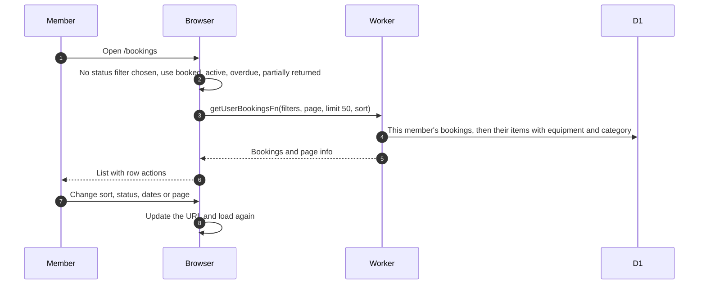
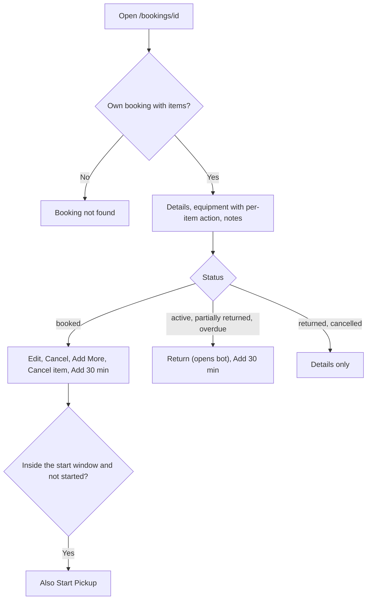

# My Bookings and booking details

## What does My Bookings show?

- Returned and cancelled bookings show only when chosen in the status filter. Sort, status, date range and page live in the URL. A date range uses the browser's time zone.
- Sort options: start time (default, oldest first), end time, status, created time, equipment name. The page has a Booking Time button for start time.
- A failed load shows an empty list.
- Row actions lead to the pages below and to [edit](edit.md) and [cancel](cancel.md).

## What does a booking's page show?

- Actions: [edit and add items](edit.md), [extend](extend.md), [cancel](cancel.md), [pickup and return](pickup-and-return.md).
- Returning needs the bot username from the environment, otherwise no Return button.
- The admin version of this page is under admin bookings.
