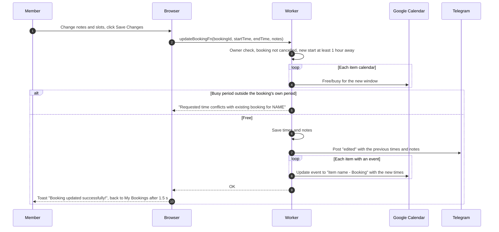
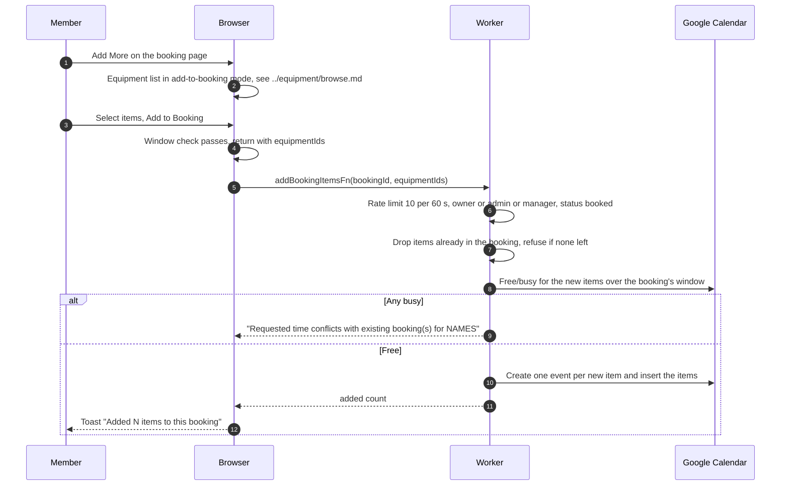

# Edit a booking and add items

Only a booking with status booked shows the edit form. Edit Booking is on the [details page](details.md).

## How does a member change time or notes?

- The page always sends times and notes, so the availability check and the 1-hour rule apply even to a notes-only edit.
- The booking's own busy period is ignored: a busy period lying fully inside the booking's current period (from the actual start if there is one) is not a conflict.
- The server does not repeat the 48 hour, 60 day or operating hours checks. Items cancelled earlier are still included in the check and event update.
- A failed event update is only logged, so the database can run ahead of the calendar.

## How does a member add equipment?

- New items use the booking's existing times and start as booked, so the booking status does not change. Dropped duplicates (including items cancelled earlier) add "K already included" to the toast.
- Membership is not rechecked here. An admin or manager can also add items to someone else's booking.
- A failed calendar write removes only the new items, see the rollback in [create](create.md). The channel gets an "items added" post.
