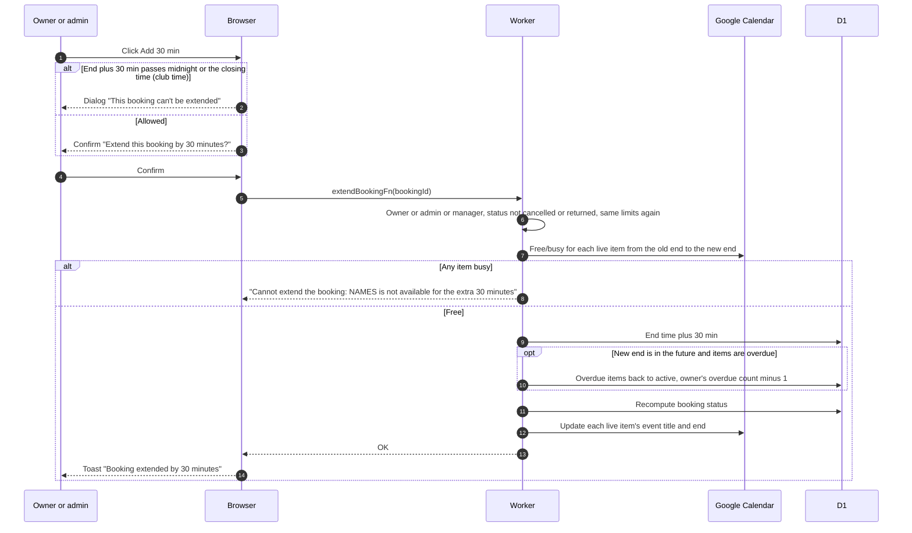

# Extend a booking

## What does "Add 30 min" do?

- The button shows for booked, active, partially returned and overdue bookings, on the details page, the edit page and the expanded list rows. It can be used repeatedly.
- The availability check runs only on confirm, and only for the extra 30 minutes.
- If the new end is still in the past, the booking stays overdue and the count is unchanged (overdue forgiveness, see [GLOSSARY](../../../../GLOSSARY.md)). The count never drops below 0. The clock marks bookings overdue, see [every 5 minutes](../../cron/every-5-min.md).
- The channel gets an "extended" post.
