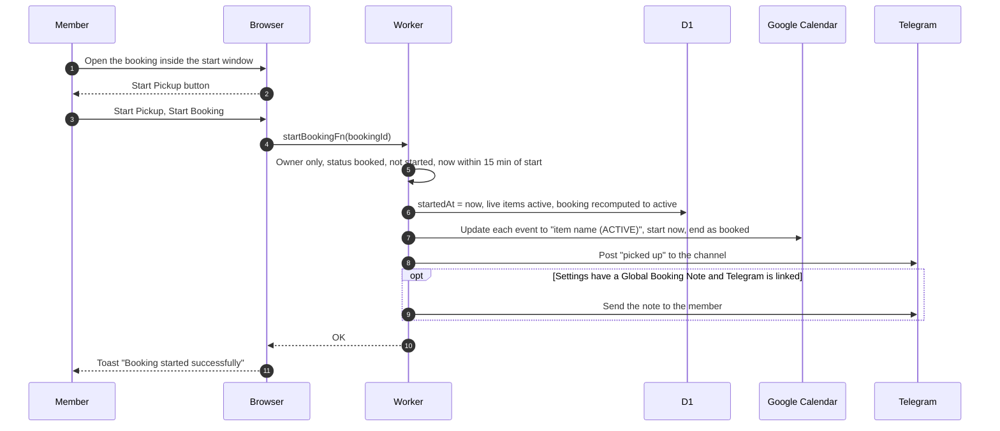
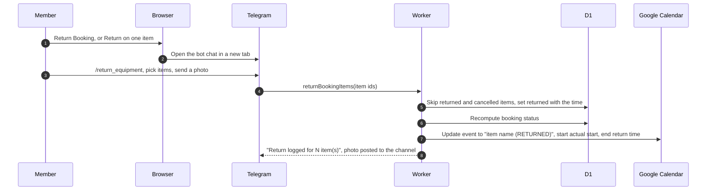

# Pickup and return

## How does a member start a booking?

- The start window is 15 minutes before to 15 minutes after the start time ([GLOSSARY](../../../../GLOSSARY.md)). Before it: "Booking can be started up to 15 minutes before the start time". After it the booking is auto-cancelled as a no-show.
- The same logic backs the bot's Start Booking, see [start booking](../telegram/start-booking.md). Admins cannot start a member's booking from the web.
- The page decides the button when it loads. A window that opens later needs a reload.

## How does a member return equipment?

- The web has no return action ([ADR-0004](../../../adr/0004-returns-are-telegram-only.md)). The link only opens the bot chat and does not pick the booking or items. Bot steps are in [return equipment](../telegram/return-equipment.md).
- Status after a return: all live items returned gives returned, some returned gives partially returned, and an overdue item keeps the booking overdue.
- The event ends at the actual return time even if later than booked. A failed event update is only logged.
