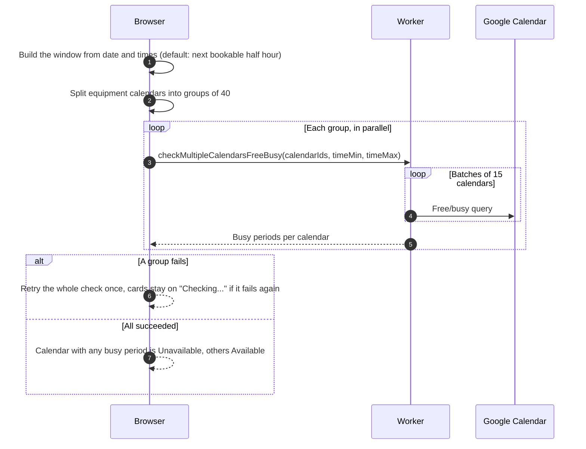
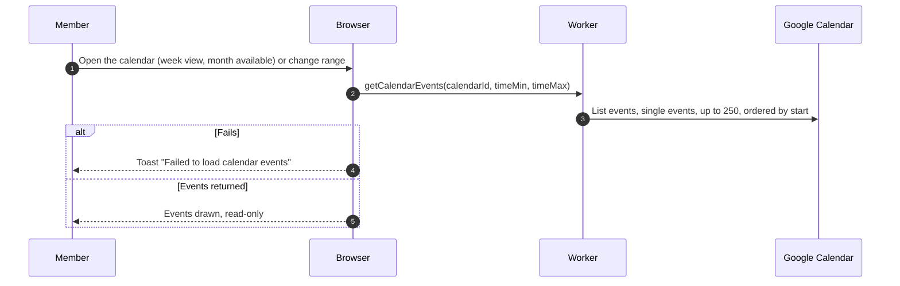

# Availability and calendar

Availability comes only from the equipment's Google Calendar, read with the club's master Google account for any signed-in user. A booking without a calendar event does not count.

## How does the list know what is free?

- Default window: the next half-hour mark at least 60 minutes from now and inside operating hours, 30 minutes long. If none fits today it moves to opening time of the next club day. Changing the date, start or end time reruns the check.
- Items already in the booking being edited show "In booking".
- The server does not check event type, so what Google counts as busy decides. A calendar Google reports an error for is treated as free.

## How does the equipment calendar load?

- Cancelled events are skipped. All-day events draw as all-day. An untitled event shows "(no title)". Beyond 250 events are not shown.
- The same calendar view backs the Availability section of the [new booking page](../bookings/create.md).
