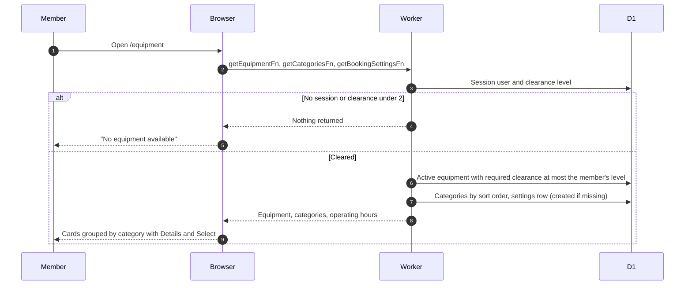
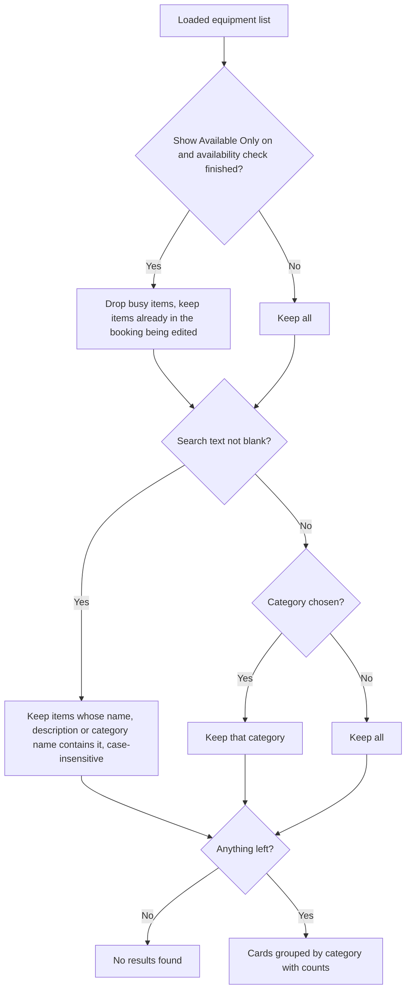
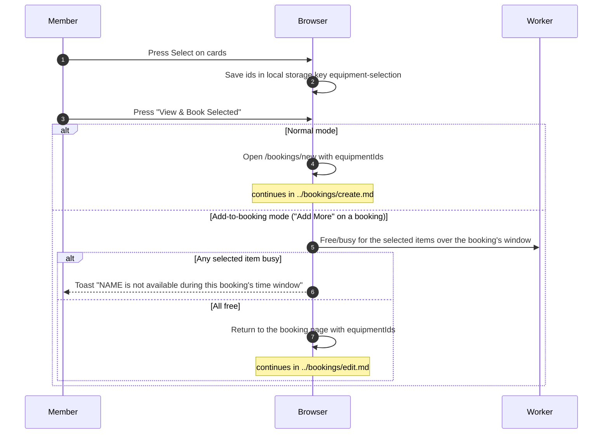

# Browse and select equipment

`/equipment` is the member's home page and the entry to booking. Equipment is created and edited by admins, see the admin equipment docs.

## What does the equipment list contain?

- A member with no stored clearance counts as level 1, so sees nothing. The page is not blocked, only the list is empty.
- The list loads once with no filters. Search, category and availability filtering run in the browser. Filters live in the URL, so reload and shared links keep them.

## How do search, category and "Show Available Only" narrow the list?

- Search waits 300 ms after typing stops. Picking a category clears the search text. If both are set, search wins.
- Busy status comes from [availability](availability.md).

## How does a member go from the list to a booking?

- A card marked "Unavailable" can still be selected in normal mode. The slot picker catches the conflict later.
- In add-to-booking mode the selection starts empty, items already in the booking are disabled, the button reads "Add to Booking", and the date and time filters are hidden because the window is the booking's own.
