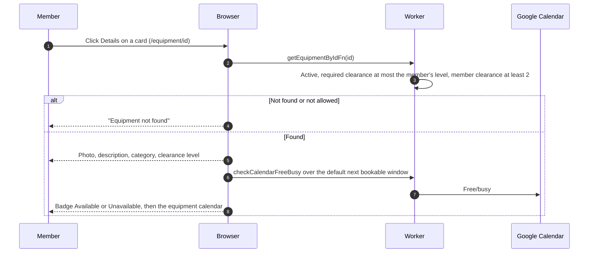

# Equipment detail

## What does the detail page show?

- The page has no booking button. Booking starts from the list, see [browse](browse.md).
- The badge uses the same default window as the list cards, see [availability](availability.md). Unlike the cards, a failed check shows "Unavailable".
- A missing, inactive or over-clearance item all show the same not-found message. A non-numeric id leaves a spinner.
- The photo is served from R2 through `/api/images/{imagePath}`, with a placeholder when missing or broken.
