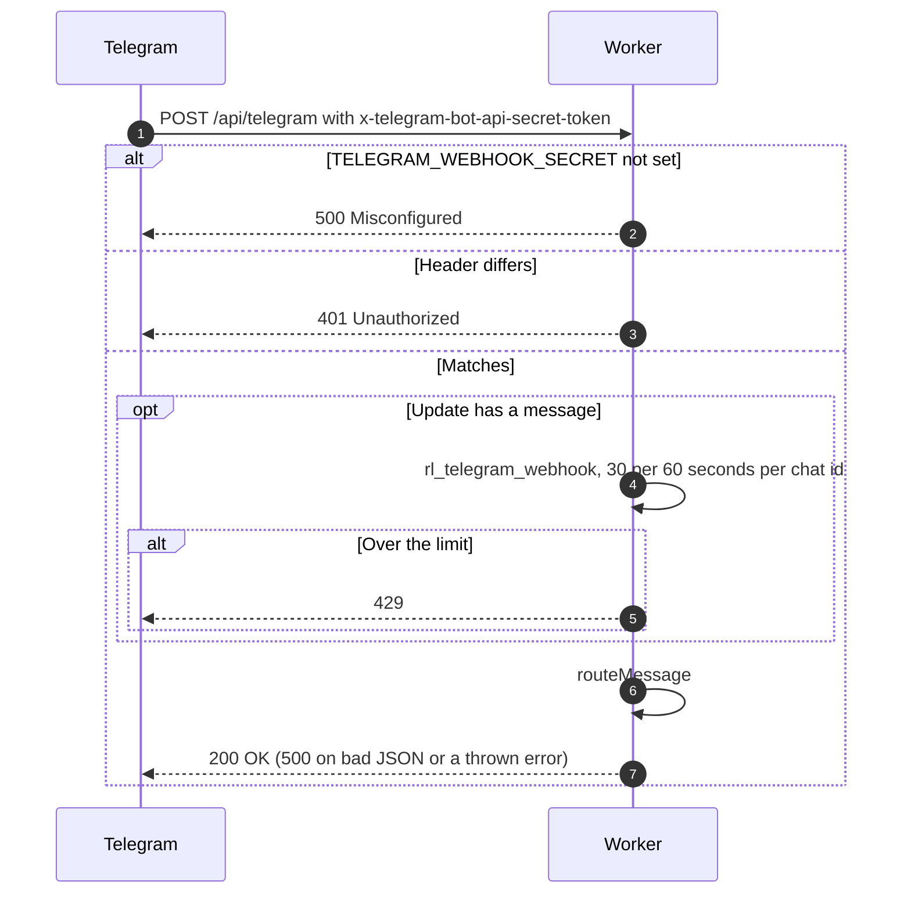
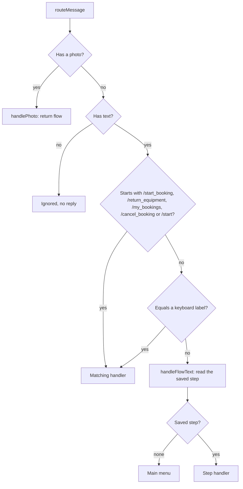

# Webhook, routing and main menu

Related: [link account](link-account.md), [booking flows](my-bookings.md).

## When does the Worker accept an update from Telegram?

The secret check fails closed. The limit is per chat, not per IP, since all updates come from Telegram. If the limiter is missing or throws, the update goes through. Updates with no message are answered 200 and ignored.

## Which handler runs for a message?

- `/start_booking` is tested before `/start`. Commands and labels are checked before the saved step, so they work in the middle of a flow.
- The keyboard has four buttons: My Bookings, Start Booking, Return Equipment, Cancel Booking. Each is sent as plain text. "🏠 Main Menu" shows the menu again. Plain labels without the emoji also work, except return, whose plain label is "End Booking".
- The saved step is one `app_state` row per chat, `session:CHATID`, expiring after 1 hour and restarted on every save. Steps are `awaiting_start_selection`, `awaiting_start_confirm`, `awaiting_booking_selection`, `awaiting_item_selection`, `awaiting_photo`, `awaiting_cancel_selection`, `awaiting_cancel_items`, `awaiting_cancel_confirm`.
- Text sent while `awaiting_photo` shows the main menu. A step that needs a linked account shows the main menu if the link is gone.
- The list handlers catch errors and reply "Error fetching bookings. Please try again." Step handling does not, so an error there ends the update with 500.
- The command list shown by Telegram holds only `/start`. It is set once per deploy by the hourly cron, see [cron](../../cron/).
