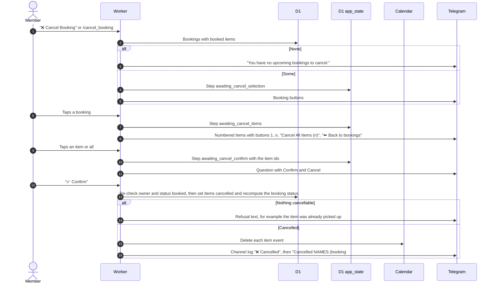

# Cancel a booking from Telegram

Related: [bot routing](bot-routing.md), [cancel on the web](../bookings/), [channel log](notifications.md).

## How does a member cancel items through the bot?

Cancelling works per item, so one item of a multi-item booking can be cancelled alone. Only items still `booked` qualify. Picked-up equipment goes through [return](return-equipment.md).

- Ownership and status are checked again at confirm, so a stale choice cannot cancel equipment picked up in the meantime.
- "Cancel" at the question returns to the item list. The saved step is not cleared after a cancel, so a second Confirm gets a refusal.
