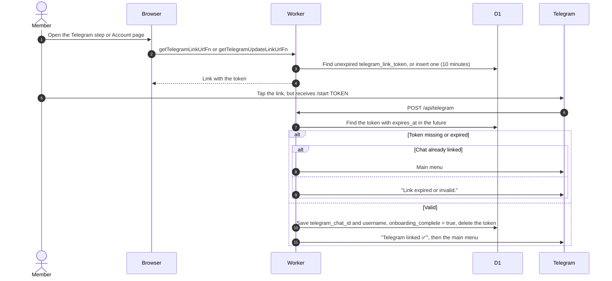

# Link a Telegram account

Related: [account](../account/), [bot routing](bot-routing.md).

## How does a member connect Telegram to their account?

The web app (onboarding step or Account page) asks for a link. The Worker makes `https://t.me/BOT?start=TOKEN`, reusing the member's unexpired token if one exists, otherwise storing a new 32 character token valid for 10 minutes. Tapping the link opens the bot and sends `/start TOKEN`.

- The onboarding call returns no link when the chat is already linked, and none when the server runs with `DEV=true`. The update call always returns a link.
- Linking again from a new chat overwrites the old chat id; the old chat then counts as unlinked. The code does not check whether the chat is linked to another account.
- Plain `/start` shows the main menu to a linked chat and "Welcome! Please use the link from the web app to connect your account." to others.
- Any error replies "Error linking account. Please try again."
- An unlinked chat gets "Please link your account via /start first." from every list command and button.
