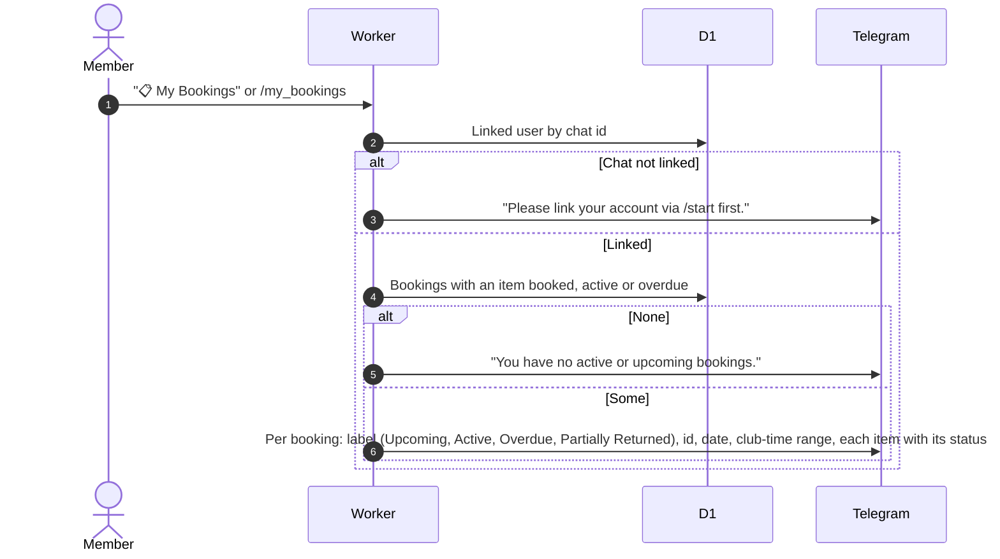

# My bookings in Telegram

Related: [start booking](start-booking.md), [cancel](cancel-booking.md), [return](return-equipment.md), [bookings on the web](../bookings/).

## What does My Bookings show?

Read-only, no step is saved. A partly returned booking appears through its items that are still out.
