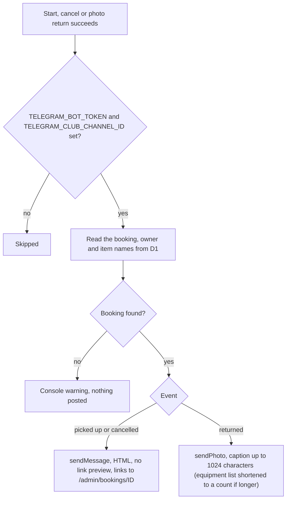
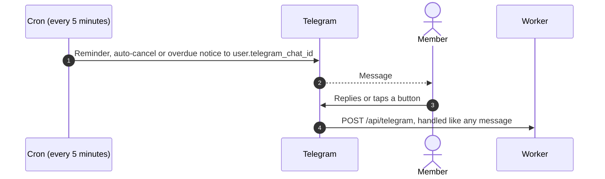

# Channel log and reminders

Related: [cron](../../cron/), [return](return-equipment.md).

## How do bot actions reach the club channel?

Starting, cancelling and returning through the bot each post to the admin channel. Posting never blocks the member's action.

- Failures are only written to the console.
- The same builder logs other events (booked, extended, edited, overdue, auto-cancelled, albums, bans), triggered elsewhere.

## Where do reminders come from?

The webhook has no handler for reminders. Timing, wording and the sent-at markers are described in [cron](../../cron/).
