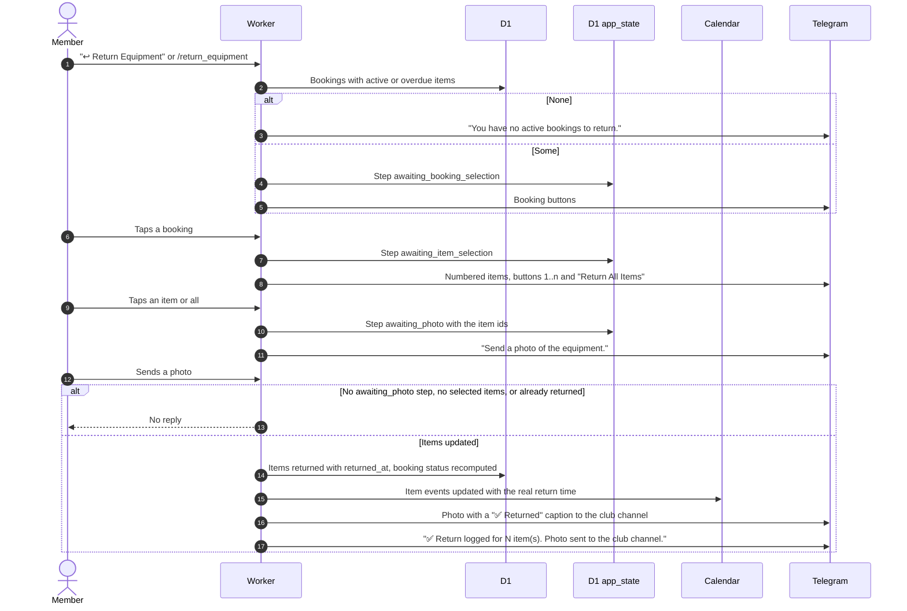

# Return equipment with a photo

Related: [ADR-0004](../../../adr/0004-returns-are-telegram-only.md), [channel log](notifications.md), [bot routing](bot-routing.md).

## How does a member return equipment?

Returns exist only in Telegram. Items with status `active` or `overdue` can be returned. There is no time filter, so an early return works.

- The largest size of the photo is forwarded. The photo handler does not check the link, it relies on the saved selection.
- On a database error the member sees "❌ Error processing return. Please try again." and can send the photo again.
- "Photo sent to the club channel." is shown even if channel logging is off or the post fails.
- Returning the last item makes the booking `returned`, see [GLOSSARY](../../../../GLOSSARY.md).
