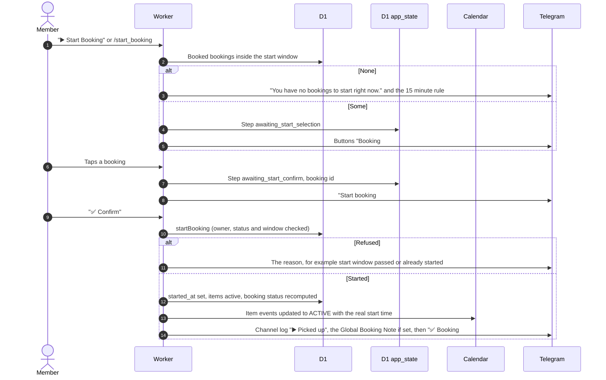

# Start a booking from Telegram

Related: [bot routing](bot-routing.md), [pickup on the web](../bookings/), [GLOSSARY: Start window](../../../../GLOSSARY.md), [channel log](notifications.md).

## How does a member pick up equipment through the bot?

- This is the same `startBooking` as the web Start pickup button. The window runs from 15 minutes before to 15 minutes after the start time.
- "Cancel" replies "Start cancelled." Other text at the confirm step gets "Send Confirm or Cancel."
- The saved step is not cleared, so a second Confirm within the hour gets a "cannot be started from status" reply.
- Calendar and channel log failures are only logged to the console.
