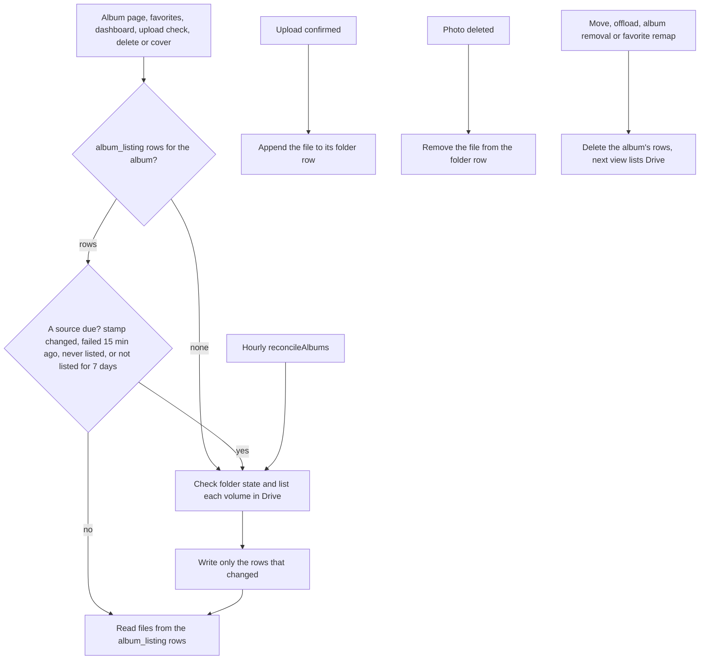

# State: album listings

Table `album_listing`, plus `album.folderState` and `album.photosCheckedAt`. Code: `src/lib/albums/listing-store.ts` (reads and writes), `listing-rows.ts` (the row plan), `listing.ts` (the rules). Decision: [ADR-0024](../../adr/0024-album-listings-are-one-row-per-folder.md). History: [ADR-0017](../../adr/0017-drop-photo-table-read-from-drive.md) cached listings, [ADR-0023](../../adr/0023-photos-are-rows-reconciled-with-drive.md) made one row per photo.

How does an album page show photos without listing Drive?

- `album_listing`: one row per folder the album's photos are listed from, keyed `(albumId, key)` where `key` is `buffer:{volumeId}`, `flamekeeper:{volumeId}` or `master` (the album's own folder, which only older albums have photos in). `folder_id` is the Drive folder, `status` is `ok`, `partial`, `failed`, `missing` or `unavailable`, `listed_at` and `failed_at` are the last attempt times, and `files` is the JSON array of Drive files as last listed (name, type, size, checksum, EXIF). A volume holds at most 256 MB, so a row stays far below D1's 2 MB row limit. The primary key is the only index: D1 bills every index entry as a row written.
- `stamp`: the volume's `expectedCount:expectedBytes` at the moment of the stored listing — the totals the app last recorded on upload confirm and photo delete. It is the app's own fingerprint of what the folder should hold, so a view can tell the stored listing is behind without calling Drive. `isDue` lists a source when the stored stamp differs from the current one. During an upload burst every confirm changes it, so it lists at most every 5 minutes while uploads are still arriving and at once after 30 seconds without one. `master` and legacy flamekeeper volumes have no expected totals, so their stamp is `''` and never changes; they are re-listed by age, failure or force. While a listing is behind the stamp (`stampStale`), the volume raises no "fewer photos than expected" warning.
- The hourly [reconcileAlbums](../cron/hourly.md) step is what notices changes made in Drive behind the app. It takes the albums checked longest ago, at most 10 an hour and usually fewer, since it only gets the requests the other steps leave. An album is eligible again 24 hours after its last check (`LISTING_RECONCILE_MS`), but with a couple of thousand albums one pass over all of them takes about two weeks.
- A view lists Drive because of age alone only when a source has gone 7 days without a listing (`LISTING_FRESH_MS`), which covers the albums the hourly step has not reached.
- A cold load spends at most 40 Drive requests (`LISTING_DRIVE_BUDGET`, the Worker run budget). A folder it could not finish is stored as `partial` with the files read so far, and is listed again 15 minutes later (`LISTING_RETRY_MS`) on the next view. An album with more volumes than one load can list therefore fills in over a few views; the hourly step and Refresh do the same work with their own budgets.
- An upload appends its file to the folder's row in one atomic statement, so the photo shows at once and the duplicate check sees it. The confirm also changes the volume's stamp, so that buffer volume is listed once more after the upload burst settles, which fills in EXIF that Drive had not extracted yet.
- A listing that found the same files writes only the small columns and leaves `files` alone. A listing that could not finish keeps the files it read, and a source that keeps failing shows its last files for up to 7 days.
- A move gives every photo a new Drive file id, so it deletes the album's rows and the next view lists Drive, as before.
- Deleting a photo and setting a cover are authorized against these rows: the file must be in a row of this album, and its source says whose token acts on it. A miss lists Drive once before refusing.
- The rows also feed the photo count and total bytes on `album` ([albums-and-storage](../erd/albums-and-storage.md)), and `album.folderState` feeds the dashboard's "folder in the bin or deleted" alert.
- Elsewhere: the public album list page (edge Cache API, 10 minutes) and guest HTML in `server.ts`.
