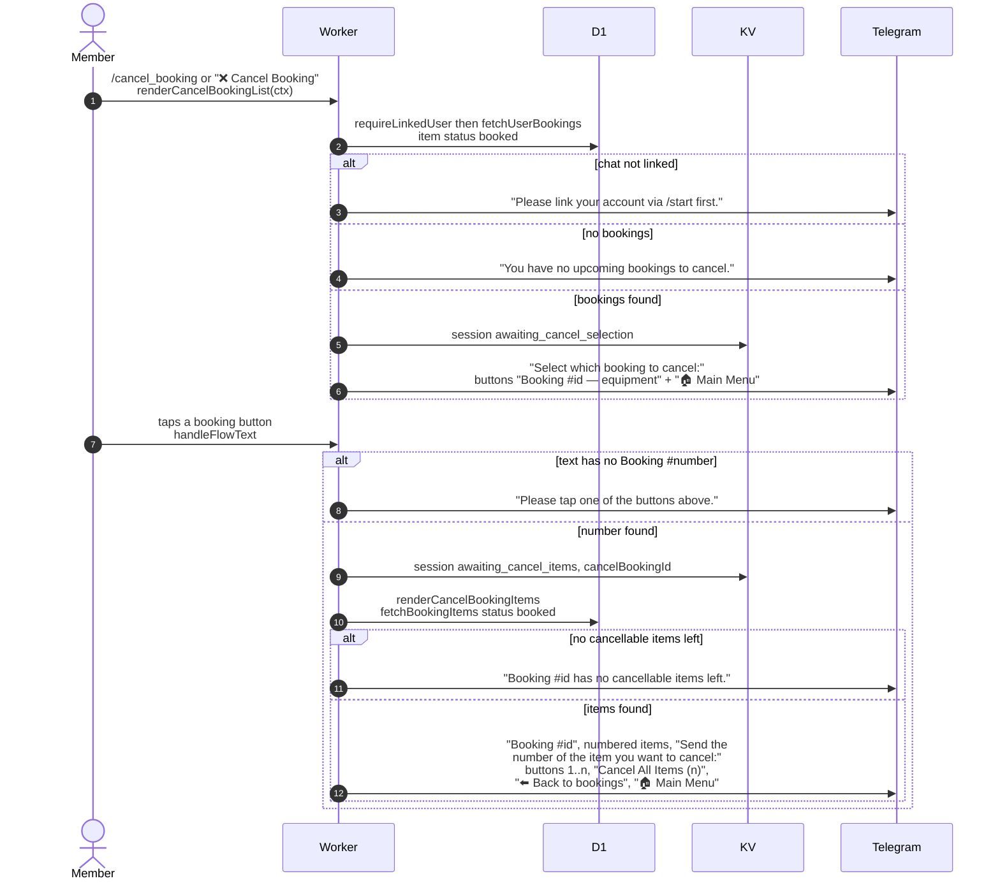

# Choosing what to cancel in Telegram

> **Question:** What happens when a member taps "Cancel Booking" or
> sends `/cancel_booking`?
>
> **Answer:** The bot lists the member's bookings that still have
> items in the "booked" state, then the items of the chosen
> booking as numbered buttons with "Cancel All Items (n)" and
> "⬅️ Back to bookings". Choosing an item or all items leads to
> the confirmation in `cancel-confirm.md`.
>
> **Notes:**
> - Only items not yet picked up can be cancelled. Picked-up
>   equipment goes through the return flow.
> - Saved steps are `awaiting_cancel_selection`, then
>   `awaiting_cancel_items`, each expiring after 1 hour.
> - The cancel is per item, so one item of a multi-item booking can
>   be cancelled alone.
> - Text that is not a booking button gets "Please tap one of the
>   buttons above."
> - If the chat is no longer linked, picking a booking gets "Please
>   link your account via /start first."

