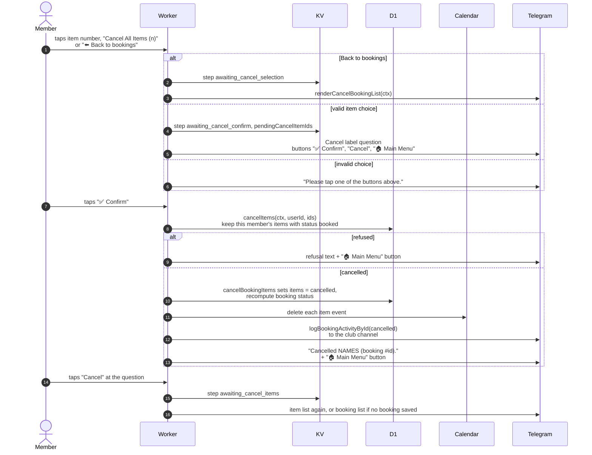

# Confirming a cancellation in Telegram

> **Question:** What happens when the member picks items to cancel
> and confirms?
>
> **Answer:** The bot asks "Cancel ...?" with Confirm and Cancel
> buttons. Confirm cancels the chosen items, recomputes the
> booking's status, deletes their calendar events and posts a
> "Cancelled" log in the club channel. The member sees
> "Cancelled NAMES (booking #35;id)." Cancel returns to the item list.
>
> **Notes:**
> - Ownership and status are re-checked at confirm time, so a stale
>   choice cannot cancel equipment that was picked up meanwhile.
> - Refusal texts: "No cancellable items found.", "Item not found.",
>   "This item has already been picked up and can only be
>   cancelled while it is still booked. Use the Return Equipment
>   flow instead." and "The selected items are already cancelled
>   or returned."
> - "⬅️ Back to bookings" goes back to the booking list.
> - The question reads `Cancel "NAME"?` for one item or
>   `Cancel all items in booking #35;id?` for all.
> - Other text at the confirm step gets "Send Confirm or Cancel."
> - If the chat is no longer linked, Confirm shows the main menu.
>   With no items saved it shows the booking list.
> - The saved step is not cleared after a cancel. Tapping Confirm
>   again gets the "already been picked up" refusal, although
>   the item was cancelled.
> - Channel log failures are logged to the console only.
> - Earlier steps are in `cancel-booking.md`. The log is in
>   `channel-log.md`.

