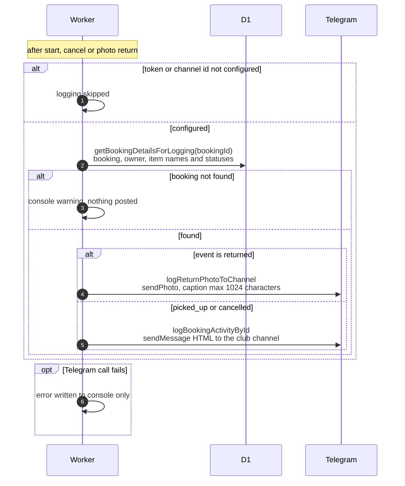

# Logging bot activity to the admin Telegram channel

> **Question:** How do actions done through the bot appear in the
> club's Telegram channel?
>
> **Answer:** Three bot actions post to the channel: starting a
> booking ("▶️ Picked up"), cancelling items ("❌ Cancelled") and
> returning with a photo ("✅ Returned", posted as a photo whose
> caption is the log). Each post is built from the booking's
> current data in the database. Posting never stops the member's
> action. Failures are only written to the console.
>
> **Notes:**
> - Logging is off unless both `TELEGRAM_BOT_TOKEN` and
>   `TELEGRAM_CLUB_CHANNEL_ID` are set.
> - Text posts use HTML formatting with link previews off. The log
>   links to `/admin/bookings/ID` when the app address is known.
> - A photo caption is limited to 1024 characters. If the full log
>   is longer, the equipment list is shortened to a count.
> - The same log builder also writes other events (booked,
>   extended, items added, edited, overdue, auto-cancelled), plus
>   album and ban logs, which other folders trigger. Overdue and
>   auto-cancelled are posted by the cron, see
>   `../cron/bookings/mark-overdue.md` and
>   `../cron/bookings/cancel-unstarted.md`.
> - A cancel logs once for each booking touched.
> - If the booking is not found, a warning is written to the
>   console and nothing is posted.

