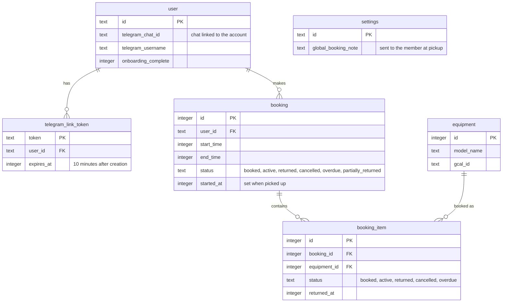

# Telegram bot data

> **Question:** Which tables and stored values does the Telegram bot
> read or write?
>
> **Answer:** The bot reads and writes `user` (to link a chat),
> `telegram_link_token` (link tokens), and `booking` and
> `booking_item` (to list, start, cancel and return), and reads
> `equipment` for names. Conversation state lives in KV, not in
> the database.
>
> **Notes:**
> - KV key `session:CHATID` holds the saved step (step, userId,
>   activeBookingIds, selectedBookingIds, selectedItemIds,
>   startBookingId, cancelBookingId, pendingCancelItemIds,
>   createdAt). TTL 1 hour, renewed on each save.
> - The rate limit counters (`rl_telegram_webhook`, 30 per 60
>   seconds per chat) live in a Cloudflare rate limit binding, not
>   in KV or D1.
> - The `settings` table column `global_booking_note` is read on
>   start, see `start-booking-confirm.md`.
> - No R2 data is used. Return photos stay in Telegram and are
>   forwarded by file id.

